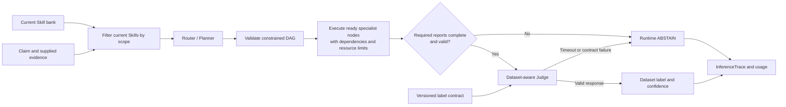
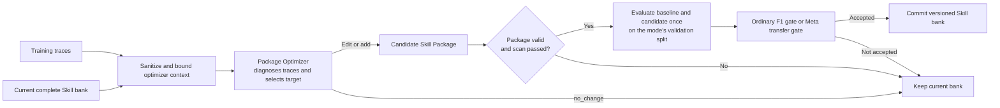
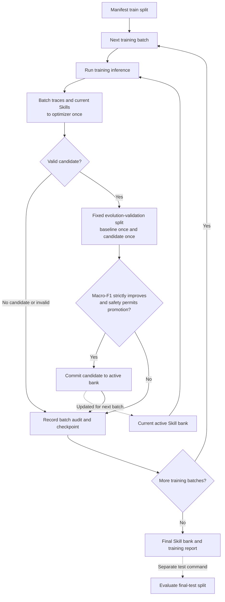
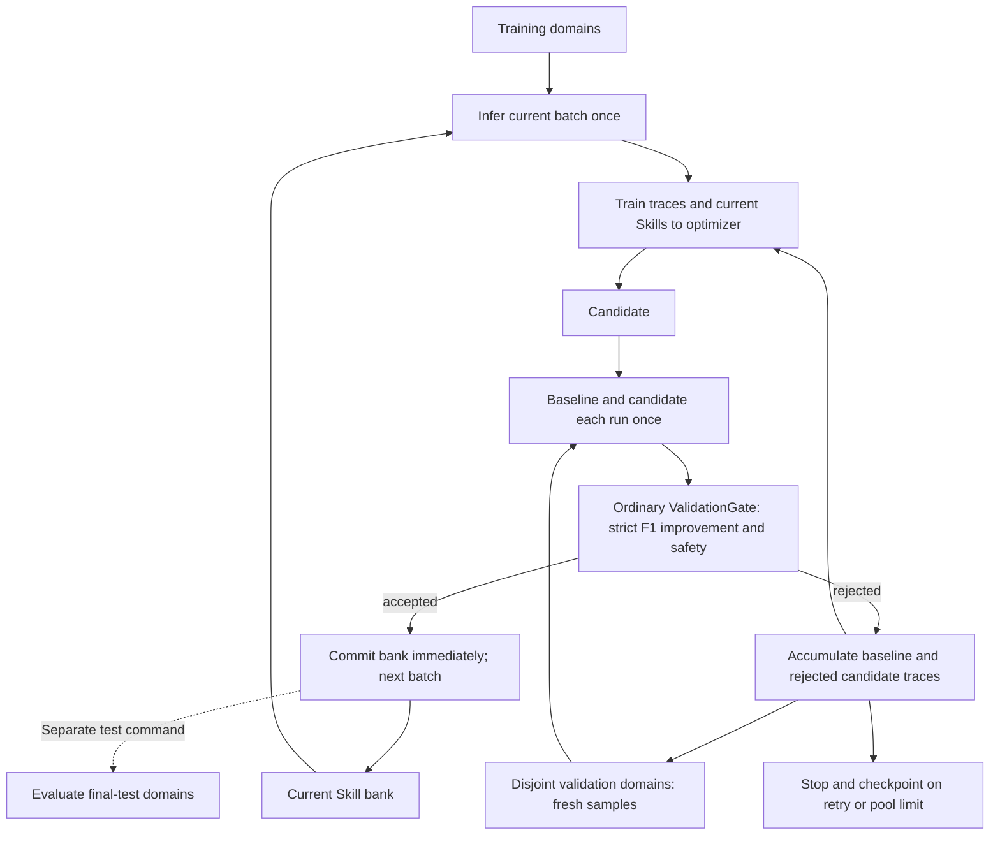
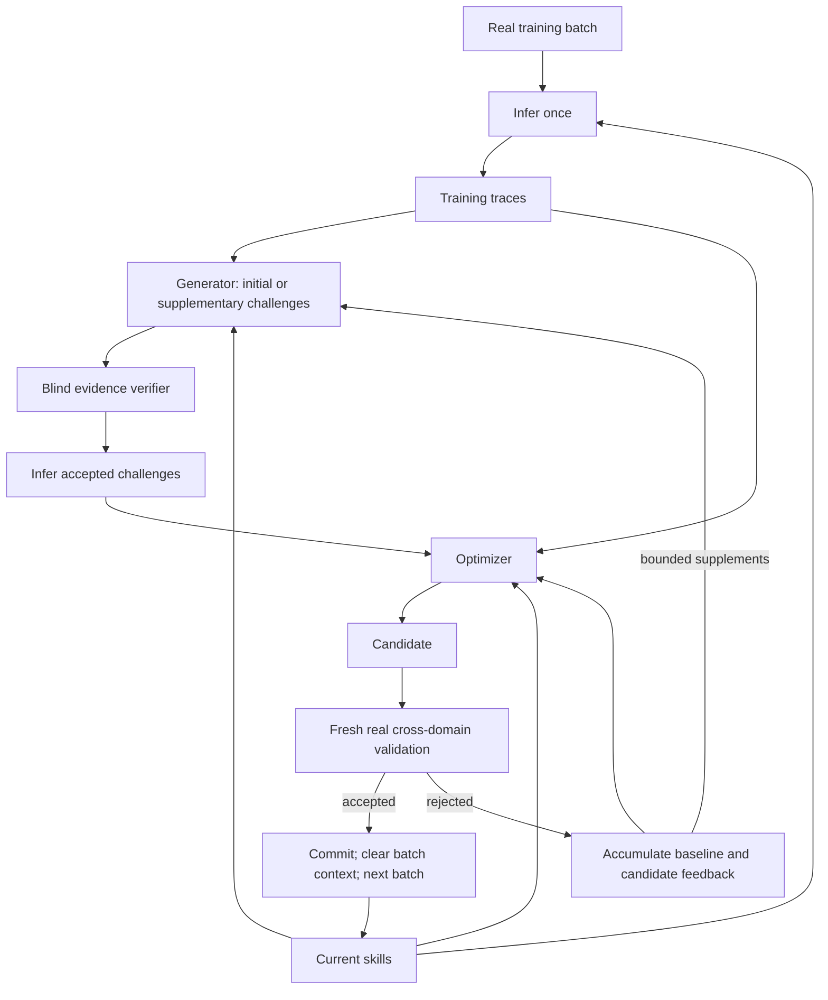

# EvoFactSkill

<p align="center">
  <b>Self-Evolving Multi-Agent System for Misinformation Detection</b>
</p>

<p align="center">
  <a href="README.md">English</a> |
  <a href="README.zh-CN.md">简体中文</a>
</p>

<p align="center">
  <a href="https://github.com/FengyuanYin/EvoFactSkill/actions/workflows/ci.yml"></a>
  = 3.11">
  <a href="LICENSE"></a>
</p>

EvoFactSkill is a research codebase for cross-domain fact verification with an evolvable multi-agent skill bank. A Router builds a constrained dependency graph, specialist agents produce structured analysis reports, and a dataset-aware Judge maps the evidence to the active dataset's label space. Evolution changes complete, versioned Skill Packages—not the weights of the underlying language model—and promotes candidates only after protected validation.

## Highlights

- **Dependency-aware multi-agent execution.** The Router returns a constrained DAG, allowing independent specialists to run concurrently while preserving required expert-to-expert dependencies.
- **Dataset-aware decisions.** Versioned label contracts constrain the Judge to the native labels of Weibo21, AMTCele, LiveFact, or AdvFake. `ABSTAIN` is reserved for Runtime failures and is not treated as a dataset label.
- **Direct trace-driven Skill evolution.** The optimizer receives training traces and the current Skill bank, diagnoses the traces, and selects the package to improve. Changes may cover instructions, manifests, schemas, scripts, and references.
- **Shared promotion gate.** Ordinary and meta evolution require strict validation macro-F1 improvement. Meta evolution uses held-out domains and feeds rejected validation traces back to the optimizer before retrying on fresh samples. Both retain automated safety checks.
- **Leakage-safe generation.** Real data is split first. Rewriting-based augmentation is restricted to meta-train; meta-test and final-test remain real-only.
- **Reproducible resource accounting.** Runs record calls, tokens, cost availability, concurrency, package digests, label-contract digests, manifests, and traces.

## Method

### Inference



`coordinator_routing` is the Router's skill package; it is not a separate Coordinator agent. The execution plan explicitly represents dependencies. Nodes at the same ready frontier may execute in parallel, while a downstream node waits for its declared predecessors.

### Evolution



Ordinary and meta evolution pass training traces and the current Skill bank directly to the Package Optimizer. It diagnoses the traces and selects a target itself; rule attribution, counterfactual replay, error clustering, and experience distillation are not performed. Each update requests one edit, specialist addition, or no_change. The optimizer package itself is fixed. Generation workflow optimization uses its separate command.

### Ordinary and meta training

| Stage | `evolve` | `meta-evolve` |
| --- | --- | --- |
| Training input | Manifest train split, consumed in sequential batches | Same manifest/selection as ordinary evolve, regrouped into mixed-domain batches with a validation domain reserved |
| Update size | `execution.batch_size` | `execution.batch_size` |
| Optimizer input | Current batch traces and the current complete Skill bank | Current batch traces, current bank, and accumulated rejected validation feedback |
| Candidate evaluation | Fixed evolution-validation split | Fresh validation samples from other source domains than the current batch; training samples may be reused |
| Inference passes | Baseline once, candidate once per candidate | Baseline once, candidate once per attempt |
| Bank update | Accepted candidates committed together at the batch boundary | Immediately after acceptance; next batch uses the updated bank |

#### Ordinary `evolve`



Ordinary evolution makes one pass over the selected training samples. Each batch uses one Skill snapshot, runs training inference, and requests one optimizer response. The optimizer may edit an eligible existing package, add a specialist when discovery is enabled, or return `no_change`. A valid candidate is evaluated independently against the batch's starting bank. Accepted updates become active before the next batch. There is no gradient update, counterfactual replay, or repeat loop. Training metrics aggregate predictions made by the successive batch snapshots; they are not a fresh evaluation of the final bank.

`execution.validate_after_each_batch: true` adds a diagnostic validation pass over the resulting active bank. It records metrics without introducing another promotion gate or automatic rollback.

#### Cross-domain `meta-evolve`



`meta-evolve` runs [MetaBatchRunner](src/evofact/experiments/meta_batch_runner.py). Failed attempts reuse the current batch's training traces and add baseline/candidate validation traces, the rejected package, and gate feedback. Each retry uses previously unseen validation samples. Acceptance commits immediately. Final-test domains never enter optimization or validation. Legacy episodic helpers remain for legacy ablation APIs.

The optimizer receives sanitized traces and current package definitions, including readable UTF-8 file contents. Ground-truth labels and dataset-label governance are filtered; traces retain the model's prediction. `max_text_chars`, `max_instructions_chars`, and `max_total_chars` bound the payload, so oversized trace lists can be shortened. Legacy attribution and distillation output fields remain empty for report/checkpoint compatibility.

### Promotion and safety

Both commands use [ValidationGate](src/evofact/validation/gate.py): candidate `macro_f1_all` must strictly exceed the baseline and pass safety checks. Episode counts, transfer confidence intervals, and generalized/specialized classifications do not participate in `meta-evolve` promotion. Ordinary evolution keeps its existing statistical reports; the batch meta report marks the unused paired test explicitly.

Scripts that pass the automated scanner receive `safe`; having a `scripts/` file alone no longer creates `review_required` or an automatic human-review risk flag. Unsafe paths, prohibited Python imports/calls, syntax errors, invalid script encoding, and missing script entrypoints can produce `blocked`. Blocked candidates cannot be promoted. An explicitly supplied `review_required` gate state still requires review. The scanner is a static rule check; `safe` means it passed those checks.

`gate.repeats` and `meta_learning.evaluation_repeats` are legacy compatibility fields: validation always runs once per arm. Ordinary `gate.min_macro_f1_gain`, coverage, calibration, domain-drop, and cost thresholds no longer control promotion. `gate.alpha` still controls reported paired statistics. Resource budgets and pricing setup validation continue to apply independently of promotion metrics.

## Installation

Requirements: Python 3.11 or newer.

```bash
git clone https://github.com/FengyuanYin/EvoFactSkill.git
cd EvoFactSkill
python -m venv .venv
```

Activate the environment, then install the project:

```bash
# Linux / macOS
source .venv/bin/activate

# Windows PowerShell
.venv\Scripts\Activate.ps1

python -m pip install -e ".[dev]"
```

No API key is required for the offline smoke test:

```bash
evofact --config configs/dry_run.yaml dry-run --output outputs/dry-run.json
```

To exercise the command paths offline:

```bash
evofact --config configs/dry_run.yaml test --output outputs/mock-test.json
evofact --config configs/dry_run.yaml evolve --evaluation-only --output outputs/mock-evolve.json
```

The mock Package Optimizer returns `no_change`, so a successful mock evolution run can have no candidates or promotions. Candidate-producing paths are covered by injected fake optimizer responses in the tests.

## Data preparation

The repository provides adapters but does not redistribute third-party datasets. Obtain each dataset from its official source, follow its license, and place the processed files under the configured `data.root`.

| Dataset ID | Adapter | Intended role |
| --- | --- | --- |
| `weibo21` | `Weibo21Adapter` | Chinese cross-domain misinformation detection |
| `amtcele` | `AMTCeleAdapter` | Dataset-specific label-contract evaluation |
| `livefact` | `LiveFactAdapter` | Dataset-specific label-contract evaluation |
| `advfake` | `AdvFakeAdapter` | Adversarial evaluation and evolution |

Select the dataset and split policy in YAML:

```yaml
data:
  dataset: weibo21
  root: datasets/Weibo21
  train_domains: [domain_a, domain_b]
  final_test_domains: [held_out_domain]
  excluded_domains: [unknown]
```

Inspect normalized samples and create the immutable split manifest before an experiment:

```bash
evofact --config configs/weibo21_cross_domain.yaml data inspect
evofact --config configs/weibo21_cross_domain.yaml \
  data manifest --output outputs/weibo21-manifest.json
```

The manifest contains stable sample fingerprints and disjoint train, evolution-validation, protected-validation, and final-test partitions. Archive it with every reported result.

## Reproducing experiments

All global options must appear before the subcommand. In particular, use `--limit`, `--batch-size`, and `--sample-concurrency` before `test`, `evolve`, or `meta-evolve`.

### Evaluation only

Evaluate the configured Weibo21 final-test samples:

```bash
evofact \
  --config configs/weibo21_cross_domain.yaml \
  --batch-size 16 \
  --sample-concurrency 8 \
  --progress \
  test --output outputs/weibo21-test.json
```

`--limit` selects source-training samples; it does not shrink this final-test set. With the current Weibo21 configuration, five final-test domains × 100 samples produce 500 test samples. `--batch-size` and `--sample-concurrency` control execution, not membership. For a smaller dataset test, use a separate YAML with a smaller `data.final_test_samples_per_domain` and an appropriate static-sample policy.

Run the same configured test split with default execution settings:

```bash
evofact --config configs/weibo21_cross_domain.yaml \
  test --output outputs/weibo21-test.json
```

Override the held-out test domain without editing YAML:

```bash
evofact --config configs/weibo21_cross_domain.yaml \
  test --final-test-domains "domain_x,domain_y" \
  --output outputs/domain-override-test.json
```

The override recomputes the source domains and manifest, then reruns leakage checks.

### Skill evolution

```bash
# One ordinary evolution run
evofact --config configs/weibo21_cross_domain.yaml \
  --limit 400 \
  --batch-size 8 \
  --sample-concurrency 4 \
  evolve \
  --checkpoint outputs/weibo21-evolve-checkpoint.json \
  --trace-log outputs/weibo21-evolve-traces.jsonl \
  --output outputs/evolve.json

# Resume after the last atomically completed batch
evofact --config configs/weibo21_cross_domain.yaml \
  --limit 400 \
  --batch-size 8 \
  --sample-concurrency 4 \
  evolve --resume \
  --checkpoint outputs/weibo21-evolve-checkpoint.json \
  --trace-log outputs/weibo21-evolve-traces.jsonl \
  --output outputs/evolve-resumed.json

# Evaluate proposals and gates without updating the active package bank
evofact --config configs/weibo21_cross_domain.yaml \
  evolve --evaluation-only --output outputs/evolve-evaluation.json

# Cross-domain batch meta-learning (validation domains must belong to source domains)
evofact --config configs/weibo21_cross_domain.yaml \
  meta-evolve --max-attempts-per-batch 5 \
  --trace-log outputs/weibo21-meta-traces.jsonl \
  --output outputs/meta-evolve.json

# Resume with the same configuration and mode
evofact --config configs/weibo21_cross_domain.yaml \
  meta-evolve --resume --max-attempts-per-batch 10 \
  --output outputs/meta-evaluation.json
```

Evolution is batch-style: every sample in one batch uses the same active package snapshot; candidate packages are considered only after the batch/validation boundary. This prevents mid-batch parameter drift.

Every training command writes detector inference traces to one UTF-8 JSONL log. `evolve` uses a run-ID-specific file by default; `meta-evolve` and `adversarial-evolve` use command-specific files under `output_dir`. Use `--trace-log` to select an explicit path. Each line contains an `InferenceTrace` and `training_context` with the run ID, task, phase, sequence number, sample position, and active Skill IDs. Logs cover training, baseline/candidate validation, meta-test, and any adversarial detector probes. Direct optimizer calls do not create detector inference traces. Generator request/response audits are stored separately.

The recommended persistent setting is `execution.trace_log` in the experiment YAML. `--trace-log` remains an optional one-run override. Resolution order is CLI override, checkpoint-recorded path during resume, YAML path, then the command default:

```yaml
execution:
  batch_size: 16
  max_concurrent_samples: 16
  progress: auto
  trace_log: outputs/weibo21_cross_domain_4/training-traces.jsonl
```

A fresh run truncates its selected trace log. `--resume` appends to the checkpoint-recorded log and refuses a missing or different file, preventing a resumed experiment from silently splitting traces across files. An interrupted, uncommitted batch can appear twice after resume; those records are intentionally retained as API-usage audit evidence and are distinguishable by `training_context.sequence` and phase.

`meta-evolve` uses these batch and validation controls:

```yaml
execution:
  batch_size: 16
data:
  evolution_validation_samples: 8
meta_learning:
  enabled: true
  checkpoint_path: outputs/meta-experiment/checkpoint.json
```

Batch meta/adversarial commands use the same manifest training split and balanced `--limit` selection as ordinary evolve, then regroup the selected IDs into mixed-domain batches. Every batch includes at least two source domains and leaves at least one source domain absent for cross-domain validation. Each validation chunk comes from other source domains than the current batch; samples used for training remain eligible for validation. Final-test domains are excluded. Omit `--validation-domains`; a global held-out source domain would change the training quotas. Each attempt uses IDs not previously consumed for validation. Retry limit (default 5), pool exhaustion, or budget failure stops at the current batch and preserves its checkpoint. Increase `--max-attempts-per-batch` when resuming after a retry limit. `training_sampling` records IDs, quotas, and batches. With 200 samples and batch size 16, both folds form 13 batches (12 of 16 and one of 8), matching ordinary evolve in batch sizes and count. Fold 1 batches contain 2-3 source domains; Fold 2 batches contain 2-4. Batch composition and order differ from ordinary evolve to reserve cross-domain validation domains. Use a separate store/checkpoint for the new layout; global-heldout and legacy episodic checkpoints are incompatible. Context limits may trim older feedback; validation budgets remain isolated and run-level usage accumulates.

Windows two-fold training, final-test, and resume commands: [ordinary evolve](docs/普通evolve实验启动教程-Windows.md), [meta-evolve](docs/meta-evolve实验启动教程-Windows.md), and [adversarial-evolve](docs/adversarial-evolve实验启动教程-Windows.md).

The forward pipeline and the training-only Package Optimizer may use different
OpenAI-compatible endpoints. Weibo21 configurations keep the inexpensive forward
model in the existing top-level fields and resolve the optimizer endpoint from
separate environment variables:

```powershell
$env:DEEPSEEK_API_KEY = "<forward-api-key>"
$env:EVOFACT_OPTIMIZER_BASE_URL = "https://<optimizer-provider>/v1"
$env:EVOFACT_OPTIMIZER_MODEL = "<advanced-model>"
$env:EVOFACT_OPTIMIZER_API_KEY = "<optimizer-api-key>"
$env:EVOFACT_OPTIMIZER_PRICING_TABLE = "pricing/<optimizer-pricing>.json"
```

```yaml
optimizer_backend:
  enabled: true
  backend: openai-compatible
  model_env: EVOFACT_OPTIMIZER_MODEL
  base_url_env: EVOFACT_OPTIMIZER_BASE_URL
  api_key_env: EVOFACT_OPTIMIZER_API_KEY
  provider: openai-compatible
  pricing_table_path_env: EVOFACT_OPTIMIZER_PRICING_TABLE
  temperature: 1.0
```

Router, Specialist, Judge, Meta-test, and final test keep
using the top-level forward model. Only `PackageOptimizerAgent` uses the optimizer
backend. When cost-aware promotion is enabled, the optimizer pricing table is
mandatory and its `provider` must match `optimizer_backend.provider`. Checkpoints
and Skill Bank provenance record both resolved model names and endpoint identities,
but never API keys. Resume fails if the effective model/pricing identity changes.

For a configured cross-domain dataset, `--limit` is the **total source-training sample limit**, not a per-domain limit and not a final-test limit. The sampler allocates it as evenly as possible across `data.train_domains` using the experiment seed. The current `configs/weibo21_cross_domain.yaml` names four source domains, so `--limit 400` requests 100 training samples per domain. If a domain lacks its nominal quota, the deficit is deterministically reassigned and disclosed in `data_sampling.train.selected_by_domain`. `data.evolution_validation_samples` independently controls ordinary evolution's validation sample count (`50` in this configuration).

The protected final-test set is configured independently:

```yaml
data:
  train_sampling: balanced_by_domain
  final_test_samples_per_domain: 100
  static_test_pattern: outputs/static/{dataset}-test-{domain}.json
  require_static_test: true
```

For Weibo21, the runtime reads the ordered `sample_id` values from each matching result under `outputs/static/` and retains the first 100. Fewer than 100 valid static samples is an error. It also fails before inference when a required file is missing, an ID is absent from the loaded dataset, or an ID belongs to another domain. Static outputs must be supplied locally; they are not downloaded by the command. The sampler is dataset-independent and can serve other registered adapters with suitable IDs, domains, and configuration. MCFEND is not currently a registered CLI dataset.

For local Weibo21 static outputs, [recompute_static_100.py](scripts/recompute_static_100.py) recomputes metrics and usage for the first 100 traces per domain and writes separate `-100.json` files. It preserves source files, makes no model calls, and compares selection against the configured local cross-domain reference result when available:

```bash
python scripts/recompute_static_100.py
python scripts/recompute_static_100.py --check
```

#### Resumable evolution protocol

Ordinary evolution writes an atomic checkpoint only after a batch has completed and its accepted Package Bank update has been committed. A checkpoint contains the number and audit records of completed batches, the exact active package mapping, accumulated traces and sample evaluations, optimizer and gate outputs, and the consumed budget state. Consequently, a resumed run preserves both the final evaluation denominator and the resource ledger of the interrupted run.

Before skipping a batch on resume, the runtime verifies the effective configuration, configuration-file digest, manifest, ordered train/validation IDs, active Package Bank, and checkpoint schema. Keep the original YAML, `--limit`, `--batch-size`, `--sample-concurrency`, split, and bank. One supported exception allows removing existing positive `max_tokens_per_sample` / `max_tokens_per_run` caps by setting them to `null`, with all other settings unchanged; the relaxation is recorded in provenance. An uncommitted batch is rerun. A `complete` checkpoint cannot be resumed; ordinary `--evaluation-only` runs use a temporary bank and do not support resume.

This protocol provides batch-boundary recovery rather than instruction-level replay. Calls issued inside an interrupted, uncommitted batch may be repeated after recovery and should be considered when reporting API usage.

#### Training provenance and Skill Bank identity

Each committed Package Bank carries machine-readable provenance. The following identifiers have distinct experimental meanings:

| Identifier | Scope | Intended use |
| --- | --- | --- |
| `training_run_id` | One concrete evolution invocation; restored unchanged by resume | Distinguish repeated runs of the same experimental configuration |
| `identity_digest` | Effective configuration, configuration file, manifest, train/validation sample sets, and limit | Detect whether two runs implement the same experimental design |
| `bank_digest` | The complete coherent Package Bank | Select and cite the exact Router/Specialist/Judge system used for inference |
| `package_digest` | One content-addressed Skill Package | Audit the exact files of an individual agent package |
| semantic version | Human-readable package release label | Describe changes; not sufficient by itself for exact reproduction |

The provenance record also contains the effective configuration, configuration-file digest, manifest ID, split fingerprints and sample counts, random seed through the effective configuration, starting bank digest, exact starting package digests and versions, and per-batch proposal/gate audit. Thus, scientific results should be reported with at least the source commit, dataset manifest ID, `training_run_id`, `identity_digest`, and final `bank_digest`.

Inspect the active bank and immutable transaction history with:

```bash
evofact --config configs/weibo21_cross_domain.yaml skills banks
evofact --config configs/weibo21_cross_domain.yaml skills bank-show active
evofact --config configs/weibo21_cross_domain.yaml \
  skills bank-export active --output outputs/weibo21-skill-bank-lock.json
```

`skills bank-show` reports package versions, exact digests, the originating run when available, and recorded provenance. `skills bank-export` writes a `skill_bank_lock_v1` lock file. The lock records identities rather than copying package contents, so the referenced content-addressed blobs must remain available in the configured `skill_store`.

#### Version-controlled inference

Inference uses the active bank by default. For a publishable or repeated experiment, export a lock file and retain it with the experiment artifacts. Place `--skill-bank` before the subcommand and select a training run ID, bank digest, or lock file to reconstruct one coherent Router/Specialist/Judge bank:

```bash
# Recommended: exported immutable lock
evofact --config configs/weibo21_cross_domain.yaml \
  --skill-bank outputs/weibo21-skill-bank-lock.json \
  test --output outputs/weibo21-locked-bank-test.json

# Equivalent selectors when the repository history is available
evofact --config configs/weibo21_cross_domain.yaml \
  --skill-bank evolve-<identity>-<run> \
  test --output outputs/weibo21-run-id-test.json

evofact --config configs/weibo21_cross_domain.yaml \
  --skill-bank <bank-digest> \
  test --output outputs/weibo21-bank-digest-test.json
```

The test report embeds the resolved bank digest, semantic versions, package digests, and available training provenance. Individual package overrides are intentionally unsupported because mixing agents from different training snapshots would invalidate the system-level experimental identity. Banks created before provenance tracking was introduced remain loadable, but their missing provenance cannot be reconstructed retrospectively and must be disclosed when reporting results.

### Unified paired ablations

```bash
evofact --config configs/weibo21_cross_domain.yaml \
  ablation \
  --arms "full,no-evolution,instructions-only,no-discovery" \
  --seeds 5 \
  --bootstrap-iterations 2000 \
  --output outputs/evolution-ablation.json
```

Every arm starts from the same seed packages, uses the same manifest and final-test sample order, and writes to an isolated temporary bank. Reports include effective settings, per-seed metrics, McNemar tests, paired bootstrap intervals, bank digests, and budgets. `no-evolution`, `no-discovery`, and `no-evidence` are paired against `full`; `instructions-only` is paired against `no-discovery`. `no-evidence` requires evidence-bearing samples. The ordinary `rule-proposer` arm is unsupported after direct trace optimization and raises an error. Meta evolution also supports `--ablation no-negative-transfer-constraint`.

The same command also accepts `meta-full` with `meta-no-cross-episode-aggregation`, `meta-no-negative-transfer-constraint`, `meta-no-worst-domain-constraint`, or `meta-no-specialization`; and `generation-full` with `generation-real-only` or `generation-rule-proposer`. Generation arms require evidence facts through `--facts`. The `unified_ablation_v2` report contains all families, one flattened run list, one summary table, and episode-paired bootstrap intervals for meta/generation controls.

### Adversarial and generator evolution

`adversarial-evolve` is a separate route implemented by [AdversarialBatchRunner](src/evofact/experiments/adversarial_batch_runner.py). Each training batch first supplies real traces and current skills to a Generator. Structurally valid challenges pass a blind evidence verifier, then detector inference produces additional optimizer traces. A rejected cross-domain validation triggers a supplementary generation round using consumed validation feedback and training-domain evidence. `--max-supplement-rounds` defaults to 2 per batch; the initial round is additional. Once the cap is reached, optimization reuses cached challenges. Every candidate is gated on fresh real cross-domain samples with the same F1 gate as meta evolution. Successful promotion clears the batch's challenges and feedback.



The three commands have separate persistent banks. Ordinary `evolve` keeps its configured paths. Meta and adversarial commands add `meta-evolve/` or `adversarial-evolve/` beneath the configured bank/output directories and beneath each checkpoint, trace, audit, or explicit output file's parent. Namespacing is idempotent. Each new route starts from seeds and cannot resume another route's checkpoint; old unnamespaced runs remain untouched. Use `--evolution-route meta-evolve` or `--evolution-route adversarial-evolve` **before** `test`/`report` to evaluate that route's bank. For independent repeats, also use distinct experiment base directories. Raw runner APIs require the caller to supply separate repositories.

```bash
# Adversarial evolution from normalized samples and verified facts
evofact --config configs/adversarial_llm.yaml \
  adversarial-evolve --max-attempts-per-batch 5 --max-supplement-rounds 2 \
  --samples data/adversarial/samples.jsonl \
  --facts data/adversarial/facts.jsonl \
  --trace-log outputs/adversarial-evolve-traces.jsonl \
  --output outputs/adversarial-evolve.json

# Inspect the batch route's generation audit
evofact generation audit outputs/adversarial-llm/adversarial-evolve/generation-audit.json

# Test the isolated adversarial bank
evofact --config configs/adversarial_llm.yaml --evolution-route adversarial-evolve \
  test --output outputs/adversarial-test.json

# Let the Package Optimizer propose a generation_agent candidate from a legacy entry audit
evofact --config configs/adversarial_llm.yaml \
  generator-evolve --audit outputs/generation-audit.json --propose-only

# Evaluate and gate a serialized candidate
evofact --config configs/adversarial_llm.yaml \
  generator-evolve \
  --candidate outputs/generator-candidate.json \
  --evaluation outputs/generator-evaluation.json
```

`generator-evolve --propose-only` prints JSON containing `candidate_package`; it does not automatically create the example candidate file. Save that package object as `outputs/generator-candidate.json`, or pass a complete package directory. Supply paired evaluation measurements separately, with matching champion/candidate digests, distinct source/evaluation episode IDs, label-contract identity, and verifier/pricing provenance. The command validates those supplied measurements.

Generated examples must preserve source lineage and pass the generation audit. The supported protocol is:

1. Split the real samples first.
2. Rewrite only real meta-train samples.
3. Combine real meta-train and accepted generated meta-train samples.
4. Keep meta-test, protected validation, and final-test real-only.

For the batch route, `generation.batch_size` caps each initial/supplementary response, `execution.batch_size` controls real training batches, and `data.evolution_validation_samples` controls each fresh validation chunk. No rule attribution, clustering, or counterfactual analysis is used. Generator responses, verification results, and challenge traces are checkpointed independently, with shared run-budget accounting. Batch audits use `adversarial_batch_audit_v1`; legacy generator-evolution entry audits retain their existing format.

### Reports

`test` now persists every completed sample immediately to `<output-stem>.samples.jsonl`, updates a separate summary at `--output`, and writes `<output-stem>.checkpoint.json`. Use the same command with `test --resume` to skip completed samples and retry errors/missing samples. `--records` and `--checkpoint` override the default paths. Without `--output`, the summary defaults to `output_dir/test-summary.json`. Existing results require `--resume` or a new output path; they are never silently overwritten.

Timeout/network errors are retried twice by default (`--sample-retries 2`), then recorded while later samples continue. An incomplete test exits with code 2 and reports metrics for completed samples only. Resume verifies model, bank, ordered samples, label contracts, pricing, and runtime policies, and restores reconciled budget usage. Usage of remote calls interrupted before reconciliation remains unknown. A partially written final journal line is repaired on resume; earlier malformed records are rejected. Historical tests that never persisted their traces cannot be recovered from a progress counter.

```bash
evofact --config configs/weibo21_cross_domain.yaml \
  report --output outputs/report.json
```

`report` runs inference to produce summary and grouped metrics. It is not an offline reader of an existing result file; a real backend can make provider calls.

`test`, `evolve`, `meta-evolve`, and `adversarial-evolve` emit UTF-8 JSON when `--output` is provided. Reports include aggregate metrics, per-domain/schema slices, resource usage, trace references, active package digests, and manifest identity when available.

## Evaluation protocol

The primary classification metrics are:

| Metric | Meaning |
| --- | --- |
| `accuracy_all` | Accuracy over every labeled sample, including Runtime failures |
| `macro_f1_all` | Schema-aware macro F1 over every labeled sample |
| `coverage` | Fraction receiving a valid non-Runtime dataset label |
| `covered_accuracy` | Accuracy only on covered samples |
| `selective_risk` | `1 - covered_accuracy` |
| `ece` | Expected calibration error |
| `brier` | Brier score, only for a binary schema with a declared positive label |
| `evidence_coverage` | Fraction of samples with evidence available to the system |
| `mean_cost` | Mean priced backend cost when the pricing table is available |
| `cost_available` | `1` only when every evaluated row has available cost information |
| `cost_coverage` | Fraction of evaluated rows with available cost information |

Always report `accuracy_all` and `macro_f1_all` with `coverage`. A high `covered_accuracy` is not meaningful if the Runtime rejects many difficult cases. `evidence_coverage = 0` indicates a no-external-evidence setting and must not be described as evidence-grounded verification.

`ABSTAIN` is a Runtime outcome for exhausted budgets, timeouts, missing required reports, or an invalid Judge response. It is not a legal label supplied to the Judge. Label order, native mappings, and optional positive labels come from versioned dataset contracts.

For datasets such as Weibo21 that do not provide an external `evidence` field, the adapter normalizes evidence to an empty collection. The Runtime marks evidence-assessment nodes optional, passes `evidence_mode: unavailable` to the Judge, and requires the Judge to decide from the claim text plus successful non-evidence specialist reports. Missing evidence alone never triggers `ABSTAIN`; `evidence_coverage` remains zero, so the run cannot be described as evidence-grounded.

## Configuration and budgets

The main experiment controls live in YAML:

```yaml
backend: openai-compatible
model: your-model-name
base_url: https://your-provider.example/v1
api_key_env: PROVIDER_API_KEY

execution:
  batch_size: 16
  max_concurrent_samples: 8
  progress: auto
  trace_log: outputs/experiment/training-traces.jsonl

evolution:
  enabled: true
  proposer: llm
  scope: package          # package | instructions
  discovery: true

budget:
  max_calls_per_run: 10000

pricing:
  provider: your-provider
  table_path: pricing/provider-date.json
  require_cost_for_promotion: true
```

For the generation-data control arm, set `generation.use_generated_in_training: false`. Generation and verification still run and remain audited, but only real construction samples enter detector evolution. `generation.proposer: rule` selects a deterministic, label-preserving surface-form baseline; its outputs still pass through the same firewall and blind verifier as LLM-generated samples.

Store credentials only in the environment variable named by `api_key_env`:

```bash
# Linux / macOS
export PROVIDER_API_KEY="..."

# Windows PowerShell
$env:PROVIDER_API_KEY="..."
```

Calls, tokens, priced cost, and concurrency are enforced at Runtime boundaries. Pricing snapshots are dated; refresh and archive the applicable provider table before a publication run.

| Setting | Current effect |
| --- | --- |
| `evolution.enabled` | Enable or freeze candidate generation |
| `evolution.scope` | `package` permits file/manifest edits; `instructions` restricts edits to the instruction entrypoint |
| `evolution.discovery` | Allow optimizer-proposed specialist additions |
| `optimizer_backend.enabled` | Use an independent optimizer backend; otherwise reuse the forward backend configuration |
| `evolution.update_interval_samples` | Meta-train update size; ordinary training uses `execution.batch_size` |
| `meta_learning.max_meta_test_samples_per_domain` | Bound each domain's meta-test sample count |
| `evolution.proposer`, `fallback_to_rule` | Legacy selectors; ordinary/meta direct optimization uses the optimizer without rule fallback |
| `max_attribution_samples_per_update`, `max_counterfactuals_per_sample` | Legacy compatibility fields; no attribution or counterfactual stage runs |

The last two rows describe ordinary/meta detector evolution. The independent `generation.proposer` still supports a rule baseline for data rewriting, and `generator-evolve` has its own candidate/evaluation contract.

## Skill packages and extensibility

Seed packages live in `skills/seeds/`. A package may contain:

```text
skill_name/
├── SKILL.md
├── metadata.json
├── scripts/
├── references/
└── schemas/
```

Specialists are discovered from validated package manifests and report schemas rather than a hard-coded Python role list. A new specialist must declare its kind, scope, triggers, capability contract, instruction entry point, and structured output schema. The Router may then select it when its contract matches the claim and dataset context.

Useful inspection commands:

```bash
evofact skills list
evofact package validate skills/seeds/temporal_reasoning
evofact package test skills/seeds/temporal_reasoning
evofact package diff path/to/before path/to/after
```

## Code entry points

| Responsibility | Source |
| --- | --- |
| Commands, dataset selection, checkpoints | [cli.py](src/evofact/cli.py) |
| Ordinary training, direct optimizer call, single-pass validation | [ExperimentRunner](src/evofact/experiments/runner.py): `evolve_once`, `closed_loop`, `closed_loop_batched` |
| Batch meta evolution, rejected-trace feedback, and resume | [MetaBatchRunner](src/evofact/experiments/meta_batch_runner.py) |
| Adversarial batch evolution with initial and failure-driven challenges | [AdversarialBatchRunner](src/evofact/experiments/adversarial_batch_runner.py) |
| Evolution-route storage namespaces | [route_isolation](src/evofact/experiments/route_isolation.py) |
| Legacy episodic helpers for ablations | [MetaEvolutionRunner](src/evofact/experiments/meta_runner.py) |
| Sanitized traces and current Skill bank payload | [optimizer_context.py](src/evofact/evolution/optimizer_context.py): `build_skillbank_optimizer_context` |
| Optimizer responses and package candidates | [package_optimizer.py](src/evofact/evolution/package_optimizer.py), [package_candidate.py](src/evofact/evolution/package_candidate.py) |
| Inference and dependency execution | [inference.py](src/evofact/runtime/inference.py), [dag_executor.py](src/evofact/runtime/dag_executor.py) |
| Ordinary and meta promotion | [gate.py](src/evofact/validation/gate.py), [meta_gate.py](src/evofact/validation/meta_gate.py) |
| Transfer evidence aggregation | [transfer.py](src/evofact/validation/transfer.py) |
| Script and package scans | [scanner.py](src/evofact/security/scanner.py), [package_scanner.py](src/evofact/security/package_scanner.py) |
| Dataset adapters, splits, and sampling | [registry.py](src/evofact/data/registry.py), [manifests.py](src/evofact/data/manifests.py), [sampling.py](src/evofact/data/sampling.py) |
| Immutable bank commits and history | [repository.py](src/evofact/skills/repository.py) |

## Repository layout

```text
EvoFactSkill/
├── configs/              # experiment configurations
├── pricing/              # dated provider pricing snapshots
├── skills/
│   ├── seeds/            # initial Router, specialist, Judge, generator, optimizer packages
│   └── store*/           # content-addressed evolved package banks
├── src/evofact/
│   ├── data/             # adapters, label contracts, manifests, leakage checks
│   ├── runtime/          # routing, DAG execution, backend, budgets, traces
│   ├── evolution/        # direct trace context and full-package optimization
│   ├── generation/       # rewriting, verification, and generation audit
│   ├── experiments/      # test, evolution, meta-learning, adversarial runners
│   ├── validation/       # fixed gates, calibration, transfer checks
│   └── reporting/        # machine-readable experiment reports
└── tests/                # offline unit, integration, and contract tests
```

## Testing

The test suite is offline and uses injected fake backends; it does not call a paid API.

```bash
python -m pytest
python -m ruff check .
python -m ruff format --check .
```

For a real backend, first validate orchestration with a small `--limit` and a strict budget. Do not infer benchmark quality from the mock backend or the dry-run fixture.

## Scope and limitations

- The repository evolves Skill Packages, not foundation-model weights.
- The Package Optimizer is fixed; self-evolution of the optimizer is not implemented.
- Retrieval is not bundled. Evidence snapshots must be provided by the dataset/workflow, and evidence-free results must be reported as such.
- The unified ablation runner covers ordinary Skill evolution, DEMSE controls, and adversarial-generation controls under one report contract.
- Dataset access, licenses, and processed-release hashes remain the experimenter's responsibility.
- Real-provider results depend on model version, rate limits, and a dated pricing snapshot.

## Citation

To cite this implementation, record the repository URL and the exact commit used for the experiment.

## License

This project is released under the [MIT License](LICENSE). Third-party datasets and model providers retain their own terms.
