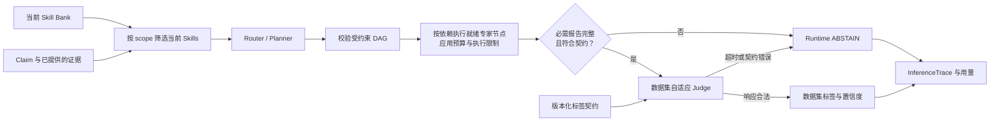
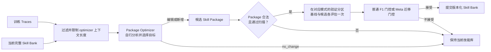
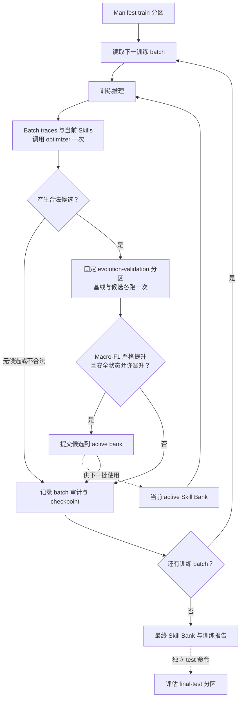
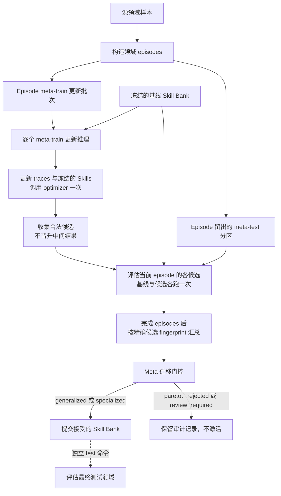

# EvoFactSkill

<p align="center">
  <b>面向虚假信息检测的自进化多智能体系统</b>
</p>

<p align="center">
  <a href="README.md">English</a> |
  <a href="README.zh-CN.md">简体中文</a>
</p>

<p align="center">
  <a href="https://github.com/FengyuanYin/EvoFactSkill/actions/workflows/ci.yml"></a>
  = 3.11">
  <a href="LICENSE"></a>
</p>

EvoFactSkill 是一个用于跨领域事实核验的研究型代码库，核心是可演化的多智能体 Skill Bank。Router 构造受约束的依赖图，专家智能体输出结构化分析报告，数据集自适应 Judge 再根据当前数据集的标签空间完成判定。演化对象是完整、版本化的 Skill Package，而不是底层大语言模型的权重；候选包只有通过受保护验证后才会被提升。

## 核心特点

- **依赖感知的多智能体执行。** Router 返回受约束 DAG：相互独立的专家可以并行执行，存在前后依赖的专家严格按拓扑顺序执行。
- **数据集自适应判定。** 版本化标签契约把 Judge 的输出限制在 Weibo21、AMTCele、LiveFact 或 AdvFake 的原生标签空间中。`ABSTAIN` 只表示 Runtime 故障，不是数据集标签。
- **直接基于 Trace 的 Skill 演化。** Optimizer 接收训练 trace 和当前技能库，自行分析并选择优化对象；修改可以覆盖指令、manifest、schema、script 和 reference。
- **独立的晋升协议。** 普通演化要求验证集 Macro-F1 严格提升；元演化检查跨 episode 的迁移收益。基线和候选各评估一次，两者均保留自动安全检查。
- **防泄漏的数据增强。** 先划分真实数据，再仅对 meta-train 执行基于真实样本的 rewriting；meta-test 和 final-test 始终保持 real-only。
- **可复现的资源核算。** 运行记录 calls、tokens、成本可用性、并发度、package digest、label-contract digest、manifest 和 trace。

## 方法概览

### 推理链路



`coordinator_routing` 是 Router 使用的 Skill Package，并不存在一个独立的 Coordinator Agent。执行计划显式记录专家依赖关系：同一就绪层中的节点可以并行，后继节点必须等待其声明的前驱完成。

### 演化链路



普通 evolve 和 meta-evolve 直接将训练 trace 和当前 Skill 库交给 Package Optimizer，由它自行分析并选择优化目标。候选生成不再执行规则错误归因、反事实回放、错误聚类或经验蒸馏。每次更新请求一次编辑、新增专家技能或 no_change；基线和候选各验证一次。Optimizer 自身保持固定，generation workflow 使用独立的优化命令。

### 普通训练与元训练

| 阶段 | `evolve` | `meta-evolve` |
| --- | --- | --- |
| 训练输入 | Manifest 的 train 分区，按顺序分批处理 | 源领域样本划分为 meta-train/meta-test episode |
| 更新粒度 | `execution.batch_size` | `evolution.update_interval_samples`；`0` 表示完整 meta-train episode |
| Optimizer 输入 | 当前 batch 的 trace 和当前完整 Skill Bank | 当前 meta-train 更新的 trace 和 episode 内冻结的 Skill Bank |
| 候选评估数据 | 固定的 evolution-validation 分区 | 当前 episode 留出的源领域 meta-test 样本 |
| 推理次数 | 每个候选的基线、候选各一次 | 每个候选在所在 episode 的基线、候选各一次 |
| 技能库更新 | batch 边界统一提交通过门控的候选 | 跨 episode 汇总后提交门控决策 |

#### 普通 `evolve`



普通演化对选中的训练样本走一遍。每个 batch 使用同一技能快照完成训练推理，再请求一次 optimizer 响应。Optimizer 可以编辑允许修改的现有技能、在 discovery 开启时新增专家技能，或者返回 `no_change`。合法候选独立地与该批开始时的技能库比较，通过后成为下一批的 active 技能。当前流程没有梯度更新、反事实回放或 repeat 循环。累计训练指标来自各批当时使用的技能快照，不代表最终技能库重新评估完整训练集的结果。

`execution.validate_after_each_batch: true` 会对提交后的 active bank 增加一次诊断性验证，只记录指标，不增加晋升门控或自动回滚。

#### 跨领域 `meta-evolve`



元演化复用相同的直接优化路径。一个 episode 内的多个更新只生成提案，不晋升中间候选；episode 评估期间基线技能库保持冻结。结果按候选的精确 fingerprint 分组，只有不同 episode 中出现的同一候选才共享迁移证据，不同改写不会被合并成一个候选。最终测试领域不参与候选生成或 meta-test 评估。

Optimizer 接收经过过滤的 trace 和当前 package 定义，其中 UTF-8 文件以可读文本提供。真实标签和数据集标签治理信息会被过滤，模型自己的预测仍保留。`max_text_chars`、`max_instructions_chars` 和 `max_total_chars` 控制上下文长度，过大的 trace 列表可能被缩短。报告和 checkpoint 中旧的归因、蒸馏字段保留为空，以兼容已有格式。

### 晋升门控与安全扫描

| 规则 | 普通 `evolve` | 元演化的泛化晋升 |
| --- | --- | --- |
| Macro-F1 收益 | 候选 `macro_f1_all` 严格高于基线 | Episode 平均收益 ≥ `meta_learning.min_mean_gain` |
| 统计证据 | 写入报告，不否决晋升 | 迁移收益置信区间下界 > `0` |
| 有效 episode | 无要求 | 至少 `min_valid_episodes` |
| 覆盖率与校准 | 写入报告，不否决晋升 | 检查 `min_coverage` 和 `max_calibration_increase` |
| 负迁移与最差领域 | 不否决晋升 | 分别由 `enforce_negative_transfer` 和 `enforce_worst_domain` 开关控制 |
| 成本可用性 | 不否决晋升 | 真实后端开启 `pricing.require_cost_for_promotion` 时要求成本可用 |
| 成本比 | 仅报告 | 仅报告 |

元演化在泛化晋升失败后仍可能接受领域特化候选。特化要求部分但非全部测试领域收益为正、有效 episode 数足够、满足覆盖率和校准约束，并通过 [MetaValidationGate](src/evofact/validation/meta_gate.py) 中额外的严重退步检查。`pareto` 状态仅保留候选供审计，不激活技能。

脚本通过自动扫描后返回 `safe`；仅包含 `scripts/` 文件不会自动产生 `review_required` 或人工审核风险标记。不安全路径、禁止的 Python 导入或调用、语法错误、脚本编码错误，以及脚本入口缺失可能产生 `blocked`，阻止候选晋升。显式传给门控的 `review_required` 状态仍要求审核。扫描器使用静态规则，`safe` 表示通过这些检查。

`gate.repeats` 和 `meta_learning.evaluation_repeats` 仅保留旧配置兼容，基线和候选固定各跑一次。普通 `gate.min_macro_f1_gain`、覆盖率、校准、领域退步和成本阈值不再控制晋升；`gate.alpha` 仍用于报告配对统计。资源预算与价格配置校验独立于晋升指标，仍然生效。

## 安装

环境要求：Python 3.11 或更高版本。

```bash
git clone https://github.com/FengyuanYin/EvoFactSkill.git
cd EvoFactSkill
python -m venv .venv
```

激活环境并安装项目：

```bash
# Linux / macOS
source .venv/bin/activate

# Windows PowerShell
.venv\Scripts\Activate.ps1

python -m pip install -e ".[dev]"
```

离线冒烟测试不需要 API Key：

```bash
evofact --config configs/dry_run.yaml dry-run --output outputs/dry-run.json
```

也可以离线检查测试与训练命令链路：

```bash
evofact --config configs/dry_run.yaml test --output outputs/mock-test.json
evofact --config configs/dry_run.yaml evolve --evaluation-only --output outputs/mock-evolve.json
```

Mock Package Optimizer 返回 `no_change`，因此成功的 mock 演化运行可以没有候选或晋升。测试套件通过注入 fake optimizer 响应覆盖实际生成候选的路径。

## 数据准备

仓库提供数据适配器，但不重新分发第三方数据集。请从数据集官方来源获取数据、遵守对应许可证，并把处理后的文件放到配置项 `data.root` 指定的位置。

| Dataset ID | Adapter | 用途 |
| --- | --- | --- |
| `weibo21` | `Weibo21Adapter` | 中文跨领域虚假信息检测 |
| `amtcele` | `AMTCeleAdapter` | 数据集标签契约评测 |
| `livefact` | `LiveFactAdapter` | 数据集标签契约评测 |
| `advfake` | `AdvFakeAdapter` | 对抗评测与演化 |

在 YAML 中选择数据集并配置领域划分：

```yaml
data:
  dataset: weibo21
  root: datasets/Weibo21
  train_domains: [domain_a, domain_b]
  final_test_domains: [held_out_domain]
  excluded_domains: [unknown]
```

正式实验前，先检查标准化样本并生成不可变的划分 manifest：

```bash
evofact --config configs/weibo21_cross_domain.yaml data inspect
evofact --config configs/weibo21_cross_domain.yaml \
  data manifest --output outputs/weibo21-manifest.json
```

Manifest 保存稳定的样本指纹，以及互不重叠的 train、evolution-validation、protected-validation 和 final-test 分区。论文结果必须连同对应 manifest 一起归档。

## 复现实验

所有全局参数必须放在子命令之前，尤其是 `--limit`、`--batch-size` 和 `--sample-concurrency`。

### 仅测试现有 Skill

评估配置指定的 Weibo21 最终测试样本：

```bash
evofact \
  --config configs/weibo21_cross_domain.yaml \
  --batch-size 16 \
  --sample-concurrency 8 \
  --progress \
  test --output outputs/weibo21-test.json
```

`--limit` 选择源领域训练样本，不缩小 final-test 集。当前 Weibo21 配置的 5 个最终测试领域各取 100 条，共 500 条。`--batch-size` 和 `--sample-concurrency` 控制执行方式，不改变测试成员。需要较小的真实数据测试时，使用独立 YAML 调小 `data.final_test_samples_per_domain`，并配置对应的静态样本策略。

使用默认执行设置评估同一份测试集：

```bash
evofact --config configs/weibo21_cross_domain.yaml \
  test --output outputs/weibo21-test.json
```

不修改 YAML，直接覆盖最终测试领域：

```bash
evofact --config configs/weibo21_cross_domain.yaml \
  test --final-test-domains "domain_x,domain_y" \
  --output outputs/domain-override-test.json
```

覆盖后系统会重新计算源领域和 manifest，并重新执行数据泄漏检查。

### Skill 演化

```bash
# 单轮普通演化
evofact --config configs/weibo21_cross_domain.yaml \
  --limit 400 \
  --batch-size 8 \
  --sample-concurrency 4 \
  evolve \
  --checkpoint outputs/weibo21-evolve-checkpoint.json \
  --trace-log outputs/weibo21-evolve-traces.jsonl \
  --output outputs/evolve.json

# 从最后一个原子完成的 batch 恢复
evofact --config configs/weibo21_cross_domain.yaml \
  --limit 400 \
  --batch-size 8 \
  --sample-concurrency 4 \
  evolve --resume \
  --checkpoint outputs/weibo21-evolve-checkpoint.json \
  --trace-log outputs/weibo21-evolve-traces.jsonl \
  --output outputs/evolve-resumed.json

# 只评估提案和门控，不更新 active package bank
evofact --config configs/weibo21_cross_domain.yaml \
  evolve --evaluation-only --output outputs/evolve-evaluation.json

# 跨领域元学习 episode
evofact --config configs/weibo21_cross_domain.yaml \
  meta-evolve --episodes 4 --strategy leave_one_domain_out \
  --trace-log outputs/weibo21-meta-traces.jsonl \
  --output outputs/meta-evolve.json

# 从 checkpoint 恢复，以只评估模式运行，不提交 active bank
evofact --config configs/weibo21_cross_domain.yaml \
  meta-evolve --resume --evaluation-only \
  --output outputs/meta-evaluation.json
```

这里的“训练”采用 batch 式 Skill 演化：同一个 batch 内的所有样本使用相同的 active package snapshot，只有到达批次/验证边界后才允许处理候选包，避免执行过程中发生中途漂移。它不是神经网络权重训练。

所有训练命令把 detector 推理轨迹写入一个 UTF-8 JSONL 日志。普通 `evolve` 默认使用带 run ID 的路径，`meta-evolve` 和 `adversarial-evolve` 默认写入 `output_dir` 下各自的命令日志。每行包含完整 `InferenceTrace` 和 `training_context`，记录 run ID、任务、阶段、序号、样本位置与 active Skill ID。日志覆盖训练、基线/候选验证、meta-test 和对抗 detector probe；optimizer 调用本身不产生 detector trace，generator 请求与响应审计单独保存。

推荐在 YAML 中固定日志路径，`--trace-log` 用于单次覆盖。路径优先级为 CLI 参数、恢复时 checkpoint 保存的路径、YAML 路径、命令默认路径：

```yaml
execution:
  batch_size: 16
  max_concurrent_samples: 16
  progress: auto
  trace_log: outputs/weibo21_cross_domain_4/training-traces.jsonl
```

新运行会截断所选日志；`--resume` 追加到 checkpoint 记录的同一日志，并拒绝缺失或不同的文件。中断后重跑尚未提交的 batch 可能留下重复记录，可通过序号和阶段区分。

`meta-evolve` 支持 episode 内的小批更新和有界 meta-test：

```yaml
evolution:
  update_interval_samples: 25
  max_proposals_per_update: 1

meta_learning:
  max_meta_test_samples_per_domain: 10
  isolate_candidate_budget: true
```

每个 leave-one-domain-out episode 的技能库保持冻结，meta-train 按 25 条一组请求候选，每次更新最多产生一个候选。候选在留出的源领域中按领域均衡、确定性地选择 meta-test 子集进行评估。`isolate_candidate_budget` 分别隔离基线和候选的样本预算，总运行账本仍持续累加。

推理模型和训练用 optimizer 可以使用不同的 OpenAI-compatible 后端。Weibo21 配置通过独立环境变量指定 optimizer：

```powershell
$env:DEEPSEEK_API_KEY = "<forward-api-key>"
$env:EVOFACT_OPTIMIZER_BASE_URL = "https://<optimizer-provider>/v1"
$env:EVOFACT_OPTIMIZER_MODEL = "<advanced-model>"
$env:EVOFACT_OPTIMIZER_API_KEY = "<optimizer-api-key>"
$env:EVOFACT_OPTIMIZER_PRICING_TABLE = "pricing/<optimizer-pricing>.json"
```

```yaml
optimizer_backend:
  enabled: true
  backend: openai-compatible
  model_env: EVOFACT_OPTIMIZER_MODEL
  base_url_env: EVOFACT_OPTIMIZER_BASE_URL
  api_key_env: EVOFACT_OPTIMIZER_API_KEY
  provider: openai-compatible
  pricing_table_path_env: EVOFACT_OPTIMIZER_PRICING_TABLE
  temperature: 1.0
```

Router、Specialist、Judge、meta-test 和最终测试使用顶层推理模型，只有 `PackageOptimizerAgent` 使用 optimizer 后端。启用成本晋升检查时必须提供 optimizer 价格表，provider 必须与 `optimizer_backend.provider` 一致。Checkpoint 和技能库溯源记录两套模型及后端身份，不记录密钥；恢复时会检查模型与价格身份是否变化。

对于已经配置领域边界的数据集，`--limit` 表示**源领域训练样本的总上限**，既不是每个领域的限额，也不控制 final-test 数量。采样器使用实验 seed，尽可能均衡地分配到 `data.train_domains`。当前 `configs/weibo21_cross_domain.yaml` 配置了 4 个源领域，`--limit 400` 请求每个领域 100 条训练样本。领域不足时缺额会确定性地重新分配，并在 `data_sampling.train.selected_by_domain` 中记录。`data.evolution_validation_samples` 独立控制普通演化的验证样本数，该配置为 `50`。

受保护的 final-test 集通过独立配置控制：

```yaml
data:
  train_sampling: balanced_by_domain
  final_test_samples_per_domain: 100
  static_test_pattern: outputs/static/{dataset}-test-{domain}.json
  require_static_test: true
```

对于 Weibo21，Runtime 按顺序读取 `outputs/static/` 下各领域历史结果的 `sample_id`，保留前 100 条。有效静态样本少于 100 条会报错；必需文件缺失、ID 不属于当前数据版本或不属于指定领域，也会在推理前失败。静态结果需在本地准备，命令不会自动下载。其他已注册适配器提供适当的 ID、领域和配置后可以复用该采样策略；MCFEND 目前不是已注册的 CLI 数据集。

本地 Weibo21 静态结果可使用 [recompute_static_100.py](scripts/recompute_static_100.py) 重算各领域前 100 条 trace 的指标与用量，输出独立的 `-100.json` 文件，保留原文件。该脚本不调用模型，在本地跨域参考结果存在时校验样本顺序一致性：

```bash
python scripts/recompute_static_100.py
python scripts/recompute_static_100.py --check
```

#### 可恢复演化协议

普通演化只会在一个 batch 完整结束且已接受的 Package Bank 更新成功提交后，原子写入 checkpoint。checkpoint 保存已完成 batch 的数量与审计记录、精确的 active package 映射、累计 trace 与逐样本评估、Optimizer 和 Gate 输出，以及已经消耗的预算状态。因此，恢复后的最终评估仍覆盖中断前的样本，资源账本也不会从零开始。

恢复时，Runtime 在跳过 batch 前校验有效配置、配置文件摘要、manifest、有序训练/验证 ID、active Package Bank 和 checkpoint schema。保持初始 YAML、`--limit`、`--batch-size`、`--sample-concurrency`、划分和技能库不变。唯一支持的配置放宽是将已有正数 `max_tokens_per_sample` / `max_tokens_per_run` 上限改为 `null`，其他设置不变，放宽信息会写入溯源。尚未提交的 batch 会重跑；`complete` checkpoint 不可恢复；普通 `--evaluation-only` 使用临时技能库，不支持恢复。

该机制提供的是 batch 边界恢复，而不是单条指令级重放。中断 batch 内已经发出但尚未形成 checkpoint 的模型调用可能在恢复后再次执行，论文报告 API 调用量和成本时应计入这一点。

#### 训练溯源与 Skill Bank 身份

每次提交的 Package Bank 都包含机器可读的训练溯源。下列标识符承担不同的科研用途：

| 标识符 | 标识范围 | 科研用途 |
| --- | --- | --- |
| `training_run_id` | 一次具体的演化运行；恢复时保持不变 | 区分使用相同实验配置重复执行的多次训练 |
| `identity_digest` | 有效配置、配置文件、manifest、训练/验证样本集合和 limit | 判断两个 run 是否属于同一实验设计 |
| `bank_digest` | 一组完整且内部一致的 Package Bank | 精确选择和引用推理所用的 Router/Specialist/Judge 系统 |
| `package_digest` | 单个内容寻址的 Skill Package | 审计某个 Agent Package 的全部文件内容 |
| 语义版本号 | 便于人工阅读的 Package 发布版本 | 描述版本变化，但不能单独用于精确复现 |

训练溯源还包含完整有效配置、配置文件摘要、manifest ID、split 指纹和样本数、有效配置中的随机种子、起始 Bank digest、起始 package 的精确 digest 与版本，以及逐 batch 的 Proposal/Gate 审计。因此，正式实验至少应同时报告源码 commit、数据 manifest ID、`training_run_id`、`identity_digest` 和最终 `bank_digest`。

使用以下命令检查 active bank 和不可变事务历史：

```bash
evofact --config configs/weibo21_cross_domain.yaml skills banks
evofact --config configs/weibo21_cross_domain.yaml skills bank-show active
evofact --config configs/weibo21_cross_domain.yaml \
  skills bank-export active --output outputs/weibo21-skill-bank-lock.json
```

`skills bank-show` 会输出 package 版本、精确 digest、可用的来源 run 和训练溯源。`skills bank-export` 会生成 `skill_bank_lock_v1` 锁文件。锁文件记录的是身份映射，不会复制 Package 内容，因此对应的内容寻址 blob 必须继续保存在当前配置的 `skill_store` 中。

#### 版本锁定推理

推理默认使用 active bank。对于论文实验或重复实验，建议导出锁文件并与实验产物一起保存。将 `--skill-bank` 放在子命令之前，可以使用训练 run ID、bank digest 或锁文件恢复一组内部一致的 Router/Specialist/Judge：

```bash
# 推荐：使用导出的不可变锁文件
evofact --config configs/weibo21_cross_domain.yaml \
  --skill-bank outputs/weibo21-skill-bank-lock.json \
  test --output outputs/weibo21-locked-bank-test.json

# 仓库仍保留历史记录时，也可以直接使用 run ID
evofact --config configs/weibo21_cross_domain.yaml \
  --skill-bank evolve-<identity>-<run> \
  test --output outputs/weibo21-run-id-test.json

# 或使用完整 Bank digest
evofact --config configs/weibo21_cross_domain.yaml \
  --skill-bank <bank-digest> \
  test --output outputs/weibo21-bank-digest-test.json
```

测试报告会嵌入最终解析得到的 bank digest、语义版本、package digest 和可用训练 provenance。项目刻意不支持单独覆盖某一个 Agent Package，因为混用不同训练快照会破坏系统级实验身份。引入溯源机制之前创建的历史 Bank 仍然可以加载，但其缺失的 provenance 无法事后重建，报告相关结果时必须明确披露这一限制。

### 统一配对消融

```bash
evofact --config configs/weibo21_cross_domain.yaml \
  ablation \
  --arms "full,no-evolution,instructions-only,no-discovery" \
  --seeds 5 \
  --bootstrap-iterations 2000 \
  --output outputs/evolution-ablation.json
```

每个实验臂从相同种子包开始，使用相同 manifest 和 final-test 样本顺序，只写入隔离的临时技能库。报告包含生效配置、逐 seed 指标、McNemar 检验、配对 Bootstrap 区间、bank digest 和预算快照。`no-evolution`、`no-discovery` 和 `no-evidence` 与 `full` 配对，`instructions-only` 与 `no-discovery` 配对。`no-evidence` 要求样本包含证据。普通 `rule-proposer` 消融在直接 trace 优化后已停用，运行会报错。元演化另外支持 `--ablation no-negative-transfer-constraint`。

同一命令还支持 `meta-full` 搭配 `meta-no-cross-episode-aggregation`、`meta-no-negative-transfer-constraint`、`meta-no-worst-domain-constraint`、`meta-no-specialization`，以及 `generation-full` 搭配 `generation-real-only`、`generation-rule-proposer`。生成消融通过 `--facts` 提供证据事实。`unified_ablation_v2` 报告统一包含各实验族、扁平 run 列表、汇总表，以及 meta/generation 的 episode 配对 Bootstrap 区间。

### 对抗演化与 Generator 演化

```bash
# 使用标准化样本和已核验事实进行对抗演化
evofact --config configs/adversarial_llm.yaml \
  adversarial-evolve \
  --samples data/adversarial/samples.jsonl \
  --facts data/adversarial/facts.jsonl \
  --trace-log outputs/adversarial-evolve-traces.jsonl \
  --output outputs/adversarial-evolve.json

# 检查 generation audit
evofact generation audit outputs/generation-audit.json

# 由 Package Optimizer 根据 audit 提出 generation_agent 候选包
evofact --config configs/adversarial_llm.yaml \
  generator-evolve --audit outputs/generation-audit.json --propose-only

# 评估并门控序列化候选包
evofact --config configs/adversarial_llm.yaml \
  generator-evolve \
  --candidate outputs/generator-candidate.json \
  --evaluation outputs/generator-evaluation.json
```

`generator-evolve --propose-only` 输出包含 `candidate_package` 的 JSON，不会自动生成示例中的候选文件。将该 package 对象保存为 `outputs/generator-candidate.json`，或者传入完整 package 目录。配对评估数据需要单独提供，包含匹配的 champion/candidate digest、不同的来源与评估 episode ID、标签契约身份，以及 verifier/pricing 溯源。该命令校验这些已提供的测量结果。

生成样本必须保留来源 lineage，并通过 generation audit。受支持的防泄漏协议如下：

1. 首先划分真实样本。
2. 只对真实 meta-train 样本进行 rewriting。
3. 合并 real meta-train 与审核通过的 generated meta-train。
4. meta-test、protected validation 和 final-test 始终使用真实数据。

### 报告

```bash
evofact --config configs/weibo21_cross_domain.yaml \
  report --output outputs/report.json
```

`report` 会运行推理来生成汇总与分组指标，不是已有结果文件的离线阅读器；真实后端可能产生模型服务调用。

为 `test`、`evolve`、`meta-evolve`、`adversarial-evolve` 指定 `--output` 后，程序会写出 UTF-8 JSON。报告包含总体指标、按领域/标签 schema 切片的指标、资源使用、trace 引用、active package digest，以及可用时的 manifest identity。

## 评估协议

主要分类指标如下：

| 指标 | 含义 |
| --- | --- |
| `accuracy_all` | 在全部有标签样本上的准确率，Runtime 故障也计入分母 |
| `macro_f1_all` | 在全部有标签样本上的 schema-aware Macro-F1 |
| `coverage` | 得到合法、非 Runtime 数据集标签的样本比例 |
| `covered_accuracy` | 仅在已覆盖样本上的准确率 |
| `selective_risk` | `1 - covered_accuracy` |
| `ece` | Expected Calibration Error |
| `brier` | 仅对声明正类的二分类 schema 计算的 Brier Score |
| `evidence_coverage` | 系统实际获得证据的样本比例 |
| `mean_cost` | 存在有效价格表时的平均后端成本 |
| `cost_available` | 所有评估行的成本信息均可用时为 `1` |
| `cost_coverage` | 成本信息可用的评估行比例 |

报告 `accuracy_all` 和 `macro_f1_all` 时必须同时报告 `coverage`。如果 Runtime 拒绝了大量困难样本，单独的高 `covered_accuracy` 没有意义。`evidence_coverage = 0` 表示无外部证据设置，不能把该结果描述为 evidence-grounded verification。

`ABSTAIN` 只表示预算耗尽、超时、必需报告缺失或 Judge 输出违反契约等 Runtime 结果。它不会作为合法标签交给 Judge。标签顺序、原生标签映射和可选正类由版本化数据集标签契约定义。

对于 Weibo21 等不提供外部 `evidence` 字段的数据集，适配器会将证据规范化为空集合。Runtime 将证据评估节点标记为可选，向 Judge 传递 `evidence_mode: unavailable`，并要求 Judge 根据声明文本和成功的非证据专家报告选择数据集合法标签。缺少 evidence 本身不会触发 `ABSTAIN`；`evidence_coverage` 仍为 0，因此该结果不能描述为证据驱动核验。

## 配置与预算

主要实验控制项均位于 YAML：

```yaml
backend: openai-compatible
model: your-model-name
base_url: https://your-provider.example/v1
api_key_env: PROVIDER_API_KEY

execution:
  batch_size: 16
  max_concurrent_samples: 8
  progress: auto

evolution:
  enabled: true
  proposer: llm
  scope: package          # package | instructions
  discovery: true

budget:
  max_calls_per_run: 10000
  max_tokens_per_run: 30000000

pricing:
  provider: your-provider
  table_path: pricing/provider-date.json
  require_cost_for_promotion: true
```

生成数据对照实验可设置 `generation.use_generated_in_training: false`。此时生成与验证仍正常执行并保留审计记录，但 detector 演化只使用真实 construction 样本。`generation.proposer: rule` 可选择确定性的标签保持表述改写基线；其输出仍必须经过与 LLM 生成样本相同的 firewall 和盲审 verifier。

密钥只应保存在 `api_key_env` 所指向的环境变量中：

```bash
# Linux / macOS
export PROVIDER_API_KEY="..."

# Windows PowerShell
$env:PROVIDER_API_KEY="..."
```

Runtime 会在边界处强制执行 calls、tokens、已计价成本和并发限制。价格快照带日期；正式论文实验前必须更新并归档当时适用的 provider 价格表。

| 配置 | 当前作用 |
| --- | --- |
| `evolution.enabled` | 开启或冻结候选生成 |
| `evolution.scope` | `package` 允许文件/manifest 修改；`instructions` 将修改限制到指令入口 |
| `evolution.discovery` | 允许 optimizer 新增专家技能 |
| `optimizer_backend.enabled` | 使用独立 optimizer 后端；关闭时复用推理后端配置 |
| `evolution.update_interval_samples` | 元训练的更新样本数；普通训练使用 `execution.batch_size` |
| `meta_learning.max_meta_test_samples_per_domain` | 限制每个领域的 meta-test 样本数 |
| `evolution.proposer`、`fallback_to_rule` | 旧选择项；普通/元训练直接调用 optimizer，不回退规则提案 |
| `max_attribution_samples_per_update`、`max_counterfactuals_per_sample` | 兼容旧配置，不执行归因或反事实阶段 |

最后两行针对普通/元 detector 演化。独立的 `generation.proposer` 仍支持数据改写的规则基线，`generator-evolve` 使用独立的候选与评估契约。

## Skill Package 与扩展新专家

种子包位于 `skills/seeds/`。一个完整 Skill Package 可以包含：

```text
skill_name/
├── SKILL.md
├── metadata.json
├── scripts/
├── references/
└── schemas/
```

专家由通过校验的 package manifest 和 report schema 动态发现，不依赖硬编码的 Python 角色列表。新增专家时，需要声明 kind、scope、triggers、能力契约、instruction entry point 和结构化输出 schema；当契约与 Claim 和数据集上下文匹配时，Router 就可以选择该专家。

常用检查命令：

```bash
evofact skills list
evofact package validate skills/seeds/temporal_reasoning
evofact package test skills/seeds/temporal_reasoning
evofact package diff path/to/before path/to/after
```

## 源码入口

| 功能 | 源码 |
| --- | --- |
| 命令、数据选择与 checkpoint | [cli.py](src/evofact/cli.py) |
| 普通训练、直接 optimizer 调用与单次验证 | [ExperimentRunner](src/evofact/experiments/runner.py)：`evolve_once`、`closed_loop`、`closed_loop_batched` |
| 元学习 episode 与冻结技能库评估 | [MetaEvolutionRunner](src/evofact/experiments/meta_runner.py) |
| Trace 过滤与当前技能库输入 | [optimizer_context.py](src/evofact/evolution/optimizer_context.py)：`build_skillbank_optimizer_context` |
| Optimizer 响应解析与候选包构建 | [package_optimizer.py](src/evofact/evolution/package_optimizer.py)、[package_candidate.py](src/evofact/evolution/package_candidate.py) |
| 推理与依赖执行 | [inference.py](src/evofact/runtime/inference.py)、[dag_executor.py](src/evofact/runtime/dag_executor.py) |
| 普通与元晋升门控 | [gate.py](src/evofact/validation/gate.py)、[meta_gate.py](src/evofact/validation/meta_gate.py) |
| 迁移证据汇总 | [transfer.py](src/evofact/validation/transfer.py) |
| 脚本与 package 安全扫描 | [scanner.py](src/evofact/security/scanner.py)、[package_scanner.py](src/evofact/security/package_scanner.py) |
| 数据适配、划分与采样 | [registry.py](src/evofact/data/registry.py)、[manifests.py](src/evofact/data/manifests.py)、[sampling.py](src/evofact/data/sampling.py) |
| 不可变技能库提交与历史 | [repository.py](src/evofact/skills/repository.py) |

## 仓库结构

```text
EvoFactSkill/
├── configs/              # 实验配置
├── pricing/              # 带日期的模型服务价格快照
├── skills/
│   ├── seeds/            # Router、专家、Judge、Generator、Optimizer 初始包
│   └── store*/           # 内容寻址的演化 Package Bank
├── src/evofact/
│   ├── data/             # Adapter、标签契约、Manifest、泄漏检查
│   ├── runtime/          # 路由、DAG 执行、后端、预算、Trace
│   ├── evolution/        # 直接 Trace 上下文与完整 Package 优化
│   ├── generation/       # Rewriting、验证与 Generation Audit
│   ├── experiments/      # Test、演化、元学习、对抗实验 Runner
│   ├── validation/       # 固定门控、校准与迁移检查
│   └── reporting/        # 机器可读实验报告
└── tests/                # 离线单元、集成与契约测试
```

## 测试

测试套件使用注入的 Fake Backend，离线运行，不会调用付费 API：

```bash
python -m pytest
python -m ruff check .
python -m ruff format --check .
```

使用真实后端时，应先通过较小的 `--limit` 和严格预算验证全链路。Mock Backend 与 dry-run fixture 的输出不能被当作论文性能结果。

## 适用范围与局限

- 本项目演化 Skill Package，不训练基础模型权重。
- Package Optimizer 保持固定，目前未实现 Optimizer 自演化。
- 仓库不内置检索系统；证据快照必须由数据集或外部 workflow 提供，无证据结果必须明确披露。
- 统一消融运行器已在同一报告契约下覆盖普通 Skill 演化、DEMSE 控制项和对抗生成控制项。
- 数据集获取、许可证合规和处理版本哈希由实验者负责。
- 真实后端结果依赖模型版本、限流策略和带日期的价格快照。

## 引用

引用本实现时，请记录仓库 URL 和实验使用的精确 commit。

## 许可证

项目代码采用 [MIT License](LICENSE)。第三方数据集和模型服务仍受各自条款约束。
