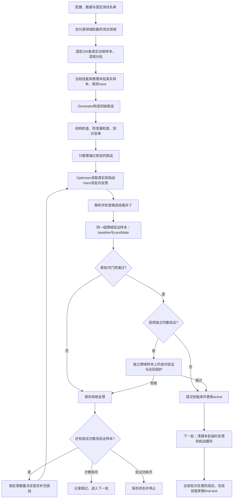

# adversarial-evolve 全流程教学：从训练样本到技能晋升与最终测试

本文对应 2026-10-19 的项目实现。以 Weibo21 两折实验为例，沿实际 CLI 调用链解释数据、智能体、对抗生成、反馈重试、验证、技能保存和断点恢复。

这是一份独立教程。阅读时可以先看第 1～4 节理解全貌，再沿第 5～10 节阅读源码，最后用第 11～14 节完成运行、排错和自测。文中的命令供手动执行，阅读文档不会启动训练。

## 1. 学完后应能回答什么

- 一条真实训练样本怎样变成 trace，又怎样触发对抗样本生成？
- Generator、Verifier、Optimizer 和负责事实判别的智能体分别做什么？
- 什么条件触发补充生成，什么条件允许技能进入 active bank？
- 为什么生成了样本、验证完成了，仍可能没有技能晋升？
- 中断后恢复哪些状态，哪些参数不能随意更改？
- 原方案与独立均衡验证方案如何保持跨域训练范式，同时保护 FAKE 召回？

这里的“训练”指使用训练样本和反馈改进 **Skill Package**。程序没有更新底层语言模型权重；变化主要发生在技能指令、资源和允许修改的清单字段中。

## 2. 先确认正在学习哪套实现

当前 `adversarial-evolve` 命令进入 [cli.py](../src/evofact/cli.py#L1098)，实例化 [AdversarialBatchRunner](../src/evofact/experiments/adversarial_batch_runner.py#L38)，再调用继承自 [MetaBatchRunner.run](../src/evofact/experiments/meta_batch_runner.py#L196) 的批处理主循环。

仓库还保留其他演化实现，以及 [Day10-挑战生成智能体与双层进化](Day10-挑战生成智能体与双层进化.md)。学习当前实验时，应以本篇指向的 CLI 与批处理代码为准：当前批路线直接消费 trace 与技能上下文，不先运行规则归因、错误聚类和反事实回放，也不会自动启动另一轮 `generator-evolve`。

| 当前流程中的组件 | 职责 | 不应混淆的地方 |
| --- | --- | --- |
| 检测流程 / `ExperimentRunner` | 调用路由、分析和判断等技能，给新闻分类，记录 trace | 既处理真实样本，也处理通过核验的挑战样本 |
| `generation_agent` / `GenerationWorkflow` | 根据有标签训练样本、模型内源知识、trace 和已消费反馈构造挑战 | 生成标签只是一个待复核的主张 |
| `ChallengeVerifier(mode="knowledge")` | 盲审生成文本的标签 | 是独立调用，不保证使用另一个模型 |
| `skill_optimizer` / `PackageOptimizerAgent` | 从整个技能库中选择需要修改或新增的技能，提出候选 | 不要求每次更新所有技能 |
| `ValidationGate` | 比较当前技能库与候选技能库 | 接收候选不等于最终测试必然提高 |
| `SkillRepository` | 保存通过验证的技能版本及 active 状态 | 训练报告 JSON 本身不是技能库 |

“良好的自进化”在这里表现为优化器能看到整个技能库，并按问题选择修改目标。它不意味着每个批次都必须修改所有 agent；是否修改、修改谁、能否晋升，需要分别检查提案和验证记录。

## 3. 用一张图串起完整生命周期



图中许多阶段会写 checkpoint。模型输出格式错误、网络中断、业务判断错误、验证拒绝和尝试次数耗尽是不同事件，后文会分别解释。

## 4. 数据怎样组织：训练、发现验证、独立验证与最终测试

### 4.1 两折实验的含义

原知识生成实验的配置为：

- [fold 1 配置](../configs/weibo21_adversarial_knowledge_fold_1.yaml)：源领域为政治、军事、科技、社会生活；最终测试领域为另外五个有效领域。
- [fold 2 配置](../configs/weibo21_adversarial_knowledge_fold_2.yaml)：源领域为财经商业、教育考试、文体娱乐、医药健康、灾难事故；最终测试领域为另外四个有效领域。

`无法确定` 领域被排除。固定 `seed: 42`，每折选择 200 条真实训练样本，与对应普通 evolve 的训练 ID 对齐。fold 1 各源领域 50 条，fold 2 各源领域 40 条。

[matched_meta_plan](../src/evofact/experiments/meta_sampling.py#L97) 与 [mixed_domain_batches](../src/evofact/experiments/meta_sampling.py#L11) 负责训练计划。`--batch-size 16` 时，200 条分成 13 批，最后一批 8 条。批次混合多个源领域，同时为跨域验证留下未出现在本批的源领域。

### 4.2 四种样本不能混为一谈

| 样本角色 | 来源与用途 | 是否进入优化器 / 生成器上下文 |
| --- | --- | --- |
| 真实训练样本 | 固定 200 条，按批产生训练 trace | 是 |
| 批内发现验证样本 | 源领域中不属于当前批领域的样本；每次候选取新的 8 条 | 已消费且候选被拒绝后，其反馈可用于下一次尝试 |
| 独立均衡验证样本（可选） | 另外预留的源领域样本；固定、均衡，用于晋升保护 | 不传正文、标签和逐样本预测；仅反馈拒绝原因 |
| 最终测试样本 | 与本折源领域不同的领域，固定名单 | 不用于训练、提案或生成 |

原 matched 路线允许某条发现验证样本在其他批次承担训练角色。它保证的是**当前批的跨域验证与发现验证样本不重复消费**，不能把它描述成训练全程完全独立的验证集。新增独立均衡验证专门提供另一层与训练隔离的检查。

发现验证的 baseline 和 candidate 使用同一组样本。下一个需要验证的提案才会取新的一组。独立池则固定复用，二者的复用规则不同。

### 4.3 三种“大小”分别控制什么

| 设置 | 当前示例值 | 实际含义 |
| --- | --- | --- |
| `--limit` | 200 | 真实训练样本总数 |
| `--batch-size` | 16 | 每批真实训练样本数 |
| `generation.batch_size` | 4 | 每轮最多生成的挑战样本数 |
| `data.evolution_validation_samples` | 8 | 每次候选的发现验证样本数 |
| `independent_validation.samples_per_domain` | 32 | 每个源领域的固定独立候选池大小 |
| `independent_validation.evaluation_samples_per_domain` | 4 | 每次从每个入选领域实际抽取的独立验证样本数，真假各 2 条 |
| `data.final_test_samples_per_domain` | 25 / 50 / 100 | 每个最终测试领域的样本数 |
| `--max-attempts-per-batch` | 5 或 10 | 每个训练批最多提出候选的尝试次数 |
| `--max-supplement-rounds` | 2 | 初始生成之外最多补充的生成轮数 |

因此，“final-test 25”在 fold 1 是 125 条，在 fold 2 是 100 条，两折合计 225 条，并非每折总共 25 条。修改测试数量应修改专用测试配置，不能依靠训练用的 `--limit`。

## 5. 从命令进入主循环：构造对象与实际执行

[evofact.cmd](../evofact.cmd) 设置 `PYTHONPATH`、切换到项目根目录，调用项目虚拟环境的 `python.exe -m evofact.cli`，并保留退出码。

核心调用链可以按下面顺序阅读：

```text
evofact.cmd
  → cli.main / _run / _run_impl
  → adversarial-evolve 分支：读取配置、选择样本与路线存储
  → AdversarialBatchRunner.__init__
      → MetaBatchRunner / MetaEvolutionRunner 初始化基础执行器和技能库
      → 创建 GenerationWorkflow(generation_agent)
      → 创建 ChallengeVerifier(mode="knowledge")
  → await AdversarialBatchRunner.run
      → 数据来源、证据时间与领域边界检查
      → await MetaBatchRunner.run
          → _prepare_plan → matched_meta_plan
          → 恢复或创建 checkpoint，检查 active bank，恢复预算
          → 本批真实推理
          → await AdversarialBatchRunner._optimizer_traces
          → await PackageOptimizerAgent.propose
          → baseline/candidate 成对验证
          → 可选独立验证
          → 反馈重试，或提交技能库并进入下一批
  → CLI 写训练报告、生成审计及指定输出
```

构造函数负责准备依赖和检查配置，**创建 runner 不等于已经调用模型**。真实调用发生在后续异步 `run`、生成、复核、提案和推理过程中。

[AdversarialBatchRunner.__init__](../src/evofact/experiments/adversarial_batch_runner.py#L43) 要求启用生成及生成样本训练，生成器类型为 `llm`。真实 CLI 不接受用普通 mock 后端冒充核验；测试可以注入专用 backend。

[run 的前置检查](../src/evofact/experiments/adversarial_batch_runner.py#L73) 还要求显式最终测试领域，检查可选 construction facts、跨域证据来源、证据时间及 test-only 标记。Weibo 没有 evidence 时，空列表可以正常通过；这些检查也服务于其他带证据的数据集。

## 6. 一个批次怎样产生可用的对抗样本

### 6.1 先运行真实样本，得到行为记录

当前 active 技能库先对本批真实样本推理。trace 记录模型经过哪些技能、产生哪些输出、最终决策、错误和用量等信息。标签来自数据集的标签契约，Weibo21 使用 REAL / FAKE 语义。

训练 trace 会缓存到 checkpoint 的 `train_traces`。批内优化重试复用它们，避免每次提案都重做同一批真实推理。

### 6.2 Generator 到底看见什么

[AdversarialBatchRunner._request](../src/evofact/experiments/adversarial_batch_runner.py#L164) 构造请求，主要包含：

- `examples`：本批真实样本、规范化训练标签、对应 trace、标签契约；数量受 `max_trace_examples` 限制。
- `skills`：当前技能库的上下文。
- `validation_feedback`：已经消费的批内拒绝反馈，优先保留近期反馈。
- `label_contracts`：合法标签及各标签的生成指导。
- `construction_facts`：可选、与本批训练样本关联的事实资料；Weibo 实验可以为空。
- `generation_memory`（可选）：启用 Generator 记忆时，包含历史协议问题、标签分歧、带检测版本的能力边界、覆盖统计及相关代表案例。只供 Generator 读取，不传给盲审 Verifier。
- `batch_size`、`id_prefix` 和生成策略版本，用于约束输出和审计。

未启用 Generator 记忆时，请求仍受原字符预算限制，必要时减少示例。启用后，改为对系统指令、工作流资源和实际请求整体执行 Generator 自身模型的 token 窗口管理，优先移出旧记忆，最后才减少当前来源示例；至少保留一个完整示例，放不下则保存停止。详见 [Generator 记忆与上下文管理](../docs/adversarial-generator记忆与上下文管理.md)。

这条路线直接从 trace 和真实标签诊断能力，不提供预先算好的 AttributionReport，也没有固定的“成功样本占多少、失败样本占多少”的抽样比例。

### 6.3 为什么 Weibo 没有 evidence 也能生成

当前生成策略是 `endogenous-knowledge-v1`，相关提示词在 [generation/prompts.py](../src/evofact/generation/prompts.py)。路线附加的知识生成规则要求模型结合训练标签与内源知识构造样本，不把“缺少外部证据”当作一律拒绝的理由。

源样本的 evidence 必须原样保留，空列表仍为空列表，不能为了通过校验编造证据。生成器应改变新闻内容与挑战方式，并保证自己给出的目标标签可成立。

输出由 `samples` 与 `decisions` 两部分组成：前者是完整 Sample 数据，后者记录生成样本对应的源样本、策略、理由和来源 trace。生成标签、生成理由属于监督和审计信息，不应塞进检测器能直接读到的 metadata 中泄露答案。

### 6.4 两层核验分别拦截什么

第一层是 [ChallengeVerifier.validate](../src/evofact/generation/verifier.py#L55) 的结构与来源检查，包括样本/决策配对、合法标签、源训练样本、策略、trace 来源、证据不可变、重复及 held-out 边界等。

如果生成器超过本轮数量上限，只有在所有样本与决策都是唯一且完整的一一配对时，[`_validate_response`](../src/evofact/experiments/adversarial_batch_runner.py#L117) 才保留前 `batch_size` 个样本和对应决策，其余记录超额拒绝。无法可靠配对的响应整轮拒绝，不随意拼接修补。

第二层是 [ChallengeVerifier.verify](../src/evofact/generation/verifier.py#L197) 的知识盲审。复核请求包含生成文本、可选证据、标签契约，以及源训练文本和真实标签；**不包含生成器拟定的目标标签、策略理由或检测器 trace**。复核模型独立给出标签，与生成标签一致才接收；不确定或不一致则拒绝。

这是一次独立复核调用，可能使用与生成器相同的模型，不能把它当作外部事实证明或绝对正确的人工标签。

只有接收的挑战才进入检测推理并产生 challenge trace。全部拒绝时，优化器仍可依靠真实训练 trace 工作，所以“程序继续训练”和“对抗增强生效”需要分别判断。

#### 6.4.1 生成器的“对抗目标”是什么

这里的对抗不是让生成器攻击程序，也不是把所有新闻都改成 FAKE，而是构造**主检测系统容易犯错、标签又能够成立**的训练案例。

对于原本判对的训练样本，生成器应增加表达或推理难度，检验模型是否真正掌握判别线索；对于原本判错的样本，则围绕同一错误机制扩展变体。例如，模型误把“官方机构背书”当成真实性保证，可以构造保留该干扰因素的不同表述，而不是只给原新闻换几个同义词。

生成器可以保持标签，也可以改变标签。决定因素是核心断言的真值条件是否改变，而不是采用哪种文风。把 FAKE 写得更正式，并不会使它变成 REAL；改变实体、数值、时间或因果关系之后，也不能机械沿用原标签。

当前可选策略来自工作流的策略注册表，代码中的基础策略见 [STRATEGIES](../src/evofact/generation/prompts.py)：

| 策略 | 想挑战的能力 | 标签处理 |
| --- | --- | --- |
| `label_preserving_rewrite` | 是否能跨措辞、句式理解同一断言 | 核心含义不变时保持原标签 |
| `style_decoupling` | 是否过度依赖情绪化、官方化或标题风格 | 文风变化不直接改变标签 |
| `target_label_transition` | 是否能识别核心事实变化 | 按修改后的事实重新确定目标标签 |
| `quantity_time_change` | 数量、日期与时间关系辨析 | 修改后必须有可说明的标签依据 |
| `attribution_scope_change` | 引述归属、适用范围与因果推断 | 不能仅因句子通顺就视为真实 |
| `minimal_contrast` | 是否注意决定真假的关键差异 | 可围绕关键改动形成不同标签的对照 |
| `success_boundary_extension` | 已会案例的能力边界 | 增加难度，但仍须能确定标签 |

基础策略文字中部分仍提到 evidence；当前知识路线附加的 `KNOWLEDGE_GENERATOR_POLICY` 明确覆盖其中“必须有外部证据”的限制。因此必须结合实际路线提示阅读，不能只看通用策略描述。

策略名和 reason 证明生成器声称采用了某种方法，不证明该方法真的造成模型错误。是否有挑战性，要看后面的 challenge trace；是否值得修改技能，要再看真实验证。

#### 6.4.2 一次生成调用怎样组装提示词

[GenerationWorkflow.run](../src/evofact/generation/workflow.py#L87) 把 `generation_agent` 包内 SKILL.md 的正文作为系统指令，追加当前批路线的说明和知识生成规则。它同时把包内 `references/` 资源及可选模板放入请求，并记录生成器包摘要。

调用之前，整个 request 会通过防泄漏检查。生成不是“先让模型选策略，再让模型填写正文”的两次调用：一次响应同时给出完整样本和策略决策。结构校验通过后，才可能发生另一次标签复核调用。

实际顺序是：

```text
有标签真实训练样本 + 检测trace + 当前技能 + 已消费反馈
    ↓ 构造request并检查held-out隔离
generation_agent指令 + 路线附加知识策略 + references / template
    ↓ 一次Generator调用
完整samples + 对应decisions
    ↓ 本地结构与来源检查
通过结构检查的样本
    ↓ 一次Verifier批量盲审调用
标签一致的样本
    ↓ 检测系统逐样本推理
challenge traces → Optimizer
```

因此 Generator、Verifier、检测器推理、Optimizer 都会消耗调用预算。生成 4 条不等于总共只发生 4 次 API 调用，核验调用也不是每条固定一次。

#### 6.4.3 samples 与 decisions：正文和审计分开保存

`samples` 是后续检测器要处理的数据；`decisions` 是解释生成来源与标签依据的审计数据。完整字段如下：

| 对象 | 字段 | 当前要求 |
| --- | --- | --- |
| Sample | `sample_id` | 使用当前轮的 `id_prefix`，且不重复 |
| Sample | `text` | 非空、满足长度上限的完整新闻文本；不能只是模板参数 |
| Sample | `label` | 生成器拟定的合法业务标签，尚需盲审 |
| Sample | `dataset`, `domain`, `event_id`, `published_at`, `evidence`, `label_schema_id` | 与选定源训练样本完全一致 |
| Sample | `metadata` | 必须是 `{}`，避免把监督答案藏进检测输入 |
| Decision | `sample_id` | 与生成样本一一对应 |
| Decision | `source_sample_id` | 必须指向本轮提供的某条真实训练示例 |
| Decision | `source_trace_ids` | 只能引用提供的 trace，并包含所选源样本的 trace |
| Decision | `strategy` | 来自允许的策略注册表 |
| Decision | `reason` | 非空，解释修改方式、目标能力及标签依据 |
| Decision | `source_label`, `target_label` | 提示词要求提供；分别对应源真实标签、生成标签，校验器为兼容旧输出允许省略 |

继承 event_id、时间和领域是当前的来源约束，不能把生成样本当作真实世界新发生事件。对抗生成改变的是文本和可成立的标签，不会自动构造一个带全新来源信息的独立新闻数据集。

#### 6.4.4 第一层逐项检查：合规不等于事实正确

本地校验不调用模型，主要判断“这个候选是否符合本轮生成协议”：

1. 顶层只能是 `samples` 与 `decisions`；二者必须是列表，数量匹配，决策 ID 不能重复。
2. 每个样本必须具有完整且仅有的 Sample 字段；ID 前缀、来源样本和引用 trace 都要合法。
3. 领域、数据集、时间、证据等继承字段不可伪造；标签必须满足标签契约。
4. 文本长度合规、metadata 为空、策略合法、理由非空。
5. 文本不能与本批真实样本或本批此前已接收挑战的规范化文本相同；当前响应中新接收的文本也参与后续去重。这里主要是小写化、空白归一后的相等比较，并非通用语义去重模型。
6. 生成样本和决策不能包含 forbidden 中受保护样本的 ID 或足够长的原文；请求和提案还各有自己的防火墙检查。

若带 evidence，通过后会把 evidence 的 `stance` 重置为 `unknown`，因为立场依赖当前断言，不能把原新闻的证据立场直接当成新新闻答案。

不同错误的处理粒度不同：顶层协议、列表配对和重复决策等错误可能导致整轮拒绝；逐个 Sample 的字段、来源、文本或标签问题，通常记录该行的拒绝原因，其他合规行继续。超额但完整配对时的前 N 条截取发生在 runner 包装层，严格校验器本身仍拒绝超额输入。

这一层通过只表示来源与结构可接受。例如，把一个真实事件的日期改错之后仍标 REAL，完全可能通过字段检查，但应在知识复核中被拒绝。

#### 6.4.5 第二层盲审：让模型重新决定生成文本的标签

复核器看到的主要内容是：

```text
生成样本：sample_id、text、evidence、label_contract
关联源样本：source_training_sample.text、source_training_sample.gold_label
```

生成器知道自己拟定的目标标签，复核器不知道。后者也看不到生成策略、reason 和检测器的判断轨迹，避免顺着生成器的解释直接认同。

源训练 gold 标签是授权监督，但只直接适用于源断言：同义改写可以继承真值；实体、数量、日期、范围和因果变化后，需要重新判断。复核器按标签契约和模型内源知识判断，不联网、不声称外部验证，空 evidence 本身不能导致拒绝。

推荐复核输出形式如下，必须每条恰好一条 review：

```json
{
  "reviews": [
    {
      "sample_id": "与待审样本ID一致",
      "status": "CLASSIFIED",
      "predicted_label": "FAKE",
      "reason": "根据源监督和内源知识对新断言的具体判断依据"
    }
  ]
}
```

`INDETERMINATE` 时 `predicted_label` 必须为 `null`。它表示无法确定，不是第三个业务标签。代码也兼容历史的 `label / reason` 输出形式，但当前提示要求上述明确状态格式。

最终接受条件很直接：

```python
accepted = (
    status == VerificationStatus.CLASSIFIED
    and verifier_predicted_label == generated_sample.label
)
```

| 生成器标签 | 复核结果 | 最终处理 |
| --- | --- | --- |
| FAKE | CLASSIFIED，预测 FAKE | 接收，进入检测推理 |
| FAKE | CLASSIFIED，预测 REAL | 拒绝，记录标签分歧 |
| REAL | INDETERMINATE，预测 null | 拒绝，记录无法确定 |
| 任意合法标签 | 漏审、重复 review、未知 ID 或响应格式错误 | 复核协议异常，可能中断本轮；不同于正常逐样本标签拒绝 |

代码不会把“生成 FAKE、复核 REAL”的样本自动改标 REAL 再加入训练。当前采用拒绝处理，保留分歧审计。

#### 6.4.6 用一个教学案例走完所有分支

假设某条训练新闻 S 的真实标签是 FAKE，检测器却因为新闻采用机构公告语气而判为 REAL。以下为流程示例，不是实验中的实际原文：

1. Generator 读取 S、FAKE 标签和误判 trace，采用 `style_decoupling`，把同一虚假核心断言改写为更正式的通告，生成候选 C，仍标 FAKE。
2. C 的 ID 使用本轮前缀，领域等来源字段复制 S，evidence 仍为 `[]`；对应 decision 引用 S 和其 trace，解释正式文风为何不改变真假。
3. 本地检查确认字段、来源、文本与隔离要求合规。若 C 只是照抄 S，会在去重阶段被拒。
4. 复核器只看到 C 的文本、标签契约，以及 S 的文本和 FAKE 真值。若判断 C 仍为 FAKE，则接收；若认为语义改变或无法确定，则拒绝。
5. 检测器用当前技能库处理通过复核的 C。如果仍判 REAL，challenge trace 暴露同类错误；如果判 FAKE，也保留这条行为记录，不会因为主系统已经判对而自动丢弃。
6. Optimizer 结合真实与挑战 trace 提出技能变化。候选是否晋升，最终仍由真实的跨域发现验证及可选独立保护决定，不能只因为“做对了自己生成的题”就提交。

#### 6.4.7 判断增强是否有效，需要看四个层次

先查看 checkpoint 当前轮或 `generation-audit.json` 的 `rounds`：

| 层次 | 记录 | 能确认什么 |
| --- | --- | --- |
| 调用发生 | `generator_usage`, `response` | 生成器产生了响应，发生了相应用量 |
| 标签可接收 | `verification.accepted`, `verification.rejected`, `verification.reviews` | 哪些通过、哪些结构被拒、哪些标签分歧或不确定 |
| 参与优化 | `traces` 及优化器 trace 来源 | 接收挑战被检测系统实际运行，并可参与后续上下文 |
| 改进有收益 | 提案、真实验证 decision、提交及最终对照测试 | 生成是否推动了可保留、可泛化的技能变化 |

可以分别统计“结构通过数 / 返回候选数”“盲审接收数 / 结构通过数”“挑战误判数 / 已推理挑战数”。超额候选、失败重试和轮次去重需要单独说明，避免混用分母。高误判率只说明当前系统在这些挑战上困难，不证明标签正确；高接收率也不代表最终泛化更好。

模型内源核验仍可能受同模型共同偏差影响：生成器和复核器可能一致地相信同一错误事实。因此盲审能减少直接附和，却不能消除事实错误。真正的收益证据来自固定真实测试上的提升，特别是各域 FAKE 召回、两类 F1 和弃权变化。

### 6.5 补充生成由什么触发

在 [_optimizer_traces](../src/evofact/experiments/adversarial_batch_runner.py#L252) 中，核心规则是：

```python
failures = len(state["feedback"])
target = 1 + min(failures, self.max_supplement_rounds)
```

假设补充上限为 2：第一次提案前生成初始一轮；第一次候选验证拒绝后可补充一轮；再次拒绝后可再补充一轮。之后继续优化仍复用已有挑战，最多三轮生成。

这里的 failures 指**已经形成验证拒绝反馈的次数**。优化器超时、无修改或非法补丁本身不会增加这个计数，不能据此推断一定补充生成。

交给优化器的 trace 顺序为：第一条真实 trace、从新到旧的挑战 trace、剩余真实 trace。优化器不再按单字符串 8,000、技能内容 60,000 或整体 300,000 字符裁剪；选入的技能内容、trace 和批内反馈在脱敏后完整传入，不因字符总量丢弃。旧 `evolution.max_*_chars` 字段保留兼容，其中 `max_total_chars` 仍单独用于生成器请求限制，不再限制优化器。模型服务本身的上下文窗口仍由服务端决定。

## 7. Optimizer 如何把反馈变成技能变化

[PackageOptimizerAgent](../src/evofact/evolution/package_optimizer.py#L375) 接收整个技能库、上述 trace，以及倒序排列的批内验证反馈。当前调用显式传入 `feedback_enabled=True`，使用具备反馈约束的优化提示。

优化器可以提出编辑已有包、新增包或 `no_change`。当前知识实验配置为 `scope: package`、允许 discovery，因此候选不局限于 judge 的 SKILL.md；实际修改目标由提案决定。

一个提案要经历 JSON 解析、允许字段检查、文件补丁及摘要检查、安全扫描等步骤。`expected digest mismatch: SKILL.md` 表示补丁声称的旧文件摘要与真实包内容不一致，不能确认补丁基于当前版本，因此拒绝应用。`unknown manifest patch fields: ['schema_version']` 则是把不允许修改的字段放进 manifest patch，属于输出契约错误。

成功解析候选后，主循环生成 proposal 并做防泄漏检查，再创建 `pending`，保存候选包、提案、验证 ID 以及 baseline/candidate 的缓存。**到这里仍未覆盖 active 技能库**。

### 一个具体例子

假设本批真实样本中，带官方机构名的谣言被判为 REAL。Generator 构造了同类带机构背书的 FAKE 文本，复核通过，检测器仍判 REAL。Optimizer 据此提出加强判断技能中的“机构名不能代替真实性判断”规则。

系统随后用其他源领域的 8 条发现验证样本比较旧、新技能。若新技能 Macro-F1 未提高，就把拒绝原因、被拒包、旧新 trace 送回本批下一次优化。下一次可以改规则、换技能目标，或不再修改。

这个例子说明的是控制流程，并非当前实验一定出现过这条具体文本或一定会修改 judge。

## 8. 什么叫晋升：原门控与独立均衡保护

### 8.1 原方案的实际判据

[MetaBatchRunner.run](../src/evofact/experiments/meta_batch_runner.py#L196) 调用的是 [ValidationGate.decide](../src/evofact/validation/gate.py#L16)。当前实际要求：发现验证上的 `macro_f1_all` 严格提高，且安全检查允许自动接受。

虽然 YAML 保留 `min_macro_f1_gain`、coverage、成本比、统计检验、以及 meta 多 episode 等字段，不能据此声称它们都参与这条批路线的晋升。当前 `ValidationGate` 的这些历史阈值没有作为拒绝条件，传入的统计结果标记为 `not_used_for_promotion`。这里也没有调用 `MetaValidationGate` 做多 episode 置信区间门控。

验证被拒后，`feedback` 保存拒绝包、门控结果、baseline trace 和 candidate trace。下一次提案仍在同一真实训练批上进行，但使用新的发现验证样本。原批内反馈在批次完成或跳过后清空。可选 `optimizer_memory.enabled: true` 会另外维护跨批经验、原始审计和 token 预算，仅用于 feedback/meta/adversarial 三条路线，普通 evolve 不接入；详见 [Optimizer 持久记忆与窗口管理](../docs/optimizer持久记忆与上下文管理.md)。

### 8.2 可选独立验证为何仍保持 meta 范式

新策略默认关闭，旧配置继续使用原行为。需要新建带时间标签的实验，使用 [独立均衡验证启动教程](../docs/独立均衡验证实验启动教程-Windows.md)。不能把独立验证配置直接接到原实验的 checkpoint 上。

配置示例：

```yaml
independent_validation:
  enabled: true
  manifest_path: <新实验目录>/validation-manifest.json
  samples_per_domain: 32
  evaluation_samples_per_domain: 4
  max_positive_recall_drop: 0.0
  max_domain_f1_drop: 0.05
  sample_retries: 2
```

[independent_pool](../src/evofact/validation/independent.py#L63) 为每个源领域固定预留 32 条，REAL / FAKE 各 16 条，排除训练、最终测试及共享来源和近重复内容。两折独立池分别是 128 和 160 条；meta 与 adversarial 的训练名单及独立名单对齐。

adversarial 仍先做混域训练，再用本批**未出现的源领域**验证。[independent_rows](../src/evofact/validation/independent.py#L134) 只从这些领域的固定池中，每域抽 4 条，REAL / FAKE 各 2 条；不会回退到本批训练领域或最终测试领域。例如本批未训练领域为科技、社会生活，则从两域各自 32 条候选中各取 4 条，本次共 8 条，baseline 和 candidate 使用同一名单。128 / 160 条候选池及其 ID 不变。

抽样由 seed 和候选验证位置确定；同一候选的 ID 写入 pending，续跑复用，不因中断换题。不同候选可以复用池中样本，不保证候选间不放回。新字段未设置时保留原行为，验证全部入选领域的独立样本。

候选先通过原发现验证，再做独立 baseline/candidate 成对推理。[guard_failures](../src/evofact/validation/independent.py#L105) 要求：

1. 独立子集整体 Macro-F1 不下降。
2. 整体及每个入选领域的正类召回不下降；Weibo21 正类是 FAKE。
3. 任一入选领域 Macro-F1 下降不超过 0.05。

独立逐样本结果留在审计中，不传给 Generator / Optimizer。优化器可以知道保护规则拒绝了候选，但不能拿独立样本正文和标签继续拟合。

固定复用的独立池仍会通过门控影响选择，所以它是训练阶段的晋升保护，不应替代最终保留测试。它减少偏向 REAL、牺牲 FAKE 召回的候选被接受的机会，不保证所有最终测试指标必然提高。

### 8.3 提交和跳过分别意味着什么

候选通过后，主循环先把 `commit_intent` 写入 checkpoint，再调用仓库提交整个期望技能库，更新 active 与当前执行器，最后清理本批状态。这使中断发生在“仓库提交”和“checkpoint 更新”之间时仍可恢复一致性。

如果达到 `max_attempts_per_batch`，记录 `skipped_batches`，保留当前技能库并自动进入下一批。如果跨域发现验证池不足，则状态为 `validation_pool_exhausted` 并停止，不循环复用旧发现样本。

所以 `completed_batches: 13` 包含已经跳过的批次，不能等同于发生 13 次晋升。应同时查看 `attempts` 的 accepted 判定、`skipped_batches` 和 `committed_snapshots`。

## 9. 把运行失败与判断错误分开

独立验证启用时，[`_clean_validation`](../src/evofact/experiments/meta_batch_runner.py#L131) 对真实训练、挑战推理、发现验证和独立验证使用严格运行失败处理：成功记录与失败尝试分别缓存，只对未成功的样本补跑。

| 情况 | 含义 | 处理方式 |
| --- | --- | --- |
| 完整输出 REAL，但真实标签 FAKE | 业务判断错误 | 正常计入指标，不因答错而重试 |
| 网络超时、HTTP 异常、解析异常、运行时错误 | 尚未得到合格推理结果 | 默认最多额外重试 2 次，记录失败类型、原因和 trace |
| 重试后仍有运行失败 | 当前阶段结果不完整 | 保存并停止，不用残缺指标晋升 |
| 原发现验证完整，但新技能分数未提高 | 候选业务效果不足 | 记录反馈，尝试下一提案 |
| Generator 输出结构不合法 | 生成契约失败 | 当前生成轮拒绝，保留记录，继续依靠可用 trace 优化 |

未恢复的阶段分别可能产生 `training_runtime_failure`、`challenge_runtime_failure`、`validation_runtime_failure`。修复后恢复同一实验，已成功样本与完整但答错的样本不重复采样。

这套严格区分是独立策略启用后的行为；旧配置未自动切换。Generator、Verifier、Optimizer 的独立模型调用仍可能直接抛出异常，应依据调用栈判断，不应假设所有调用都享受上述样本级重试。

`TimeoutError: The read operation timed out` 是等待模型服务响应超时，通常与请求耗时、网络或服务端有关，和文件读取权限不是同一类问题。提高每批尝试上限只能增加机会，无法直接修复服务超时。

## 10. checkpoint、反馈审计与技能库各存什么

原知识实验每折大致有以下文件，具体路径由配置决定：

```text
docs/weibo21_adversarial_knowledge_fold_1/adversarial-evolve/
├── train-checkpoint.json       # 可恢复的运行状态，最重要
├── train.json                  # --output 指定的训练总结
├── adversarial-batch-report.json
├── generation-audit.json       # 完成生成轮的请求、响应、核验和推理记录
├── training-traces.jsonl       # 推理 trace 日志
├── final-test-25.json          # 每领域25条的最终测试总结
├── final-test-25.samples.jsonl # 测试逐样本记录
└── final-test-25.checkpoint.json

skills/store_weibo21_adversarial_knowledge_fold_1/adversarial-evolve/
└── active.json                # 当前生效技能的仓库索引
```

checkpoint 中值得先读的字段：

| 字段 | 用途 |
| --- | --- |
| `schema_version` / `identity` | 路线和运行身份校验 |
| `status` / `completed_batches` / `total_batches` | 运行进度；异常后的 running 不证明进程还活着 |
| `attempt` / `attempts` / `skipped_batches` | 本批尝试、历次结论及跳过记录 |
| `training_plan` / `used_validation_ids` | 训练名单、分批与已消费发现验证样本 |
| `train_traces` / `feedback` | 本批真实推理缓存及拒绝反馈 |
| `adversarial_batch` / `generation_audit` | 当前生成轮状态与已完成生成审计 |
| `pending` | 待验证候选、验证样本及旧新结果缓存 |
| `packages` / `commit_intent` | 预期技能库及提交恢复信息 |
| `budget` | 已使用与剩余预算状态 |

生成轮分别保存 response、verification、traces，因此在生成完成后中断，可以继续复核或推理，不必重新生成；成对验证也可复用已完成的一侧。启用严格运行处理后，还会缓存逐样本成功记录和失败尝试。

恢复会核对配置、数据指纹、训练计划、生成策略摘要、生成器摘要、补充上限及 active bank 等。不要改配置、数据、技能库或输出日志后硬接旧断点；策略改变时建立新实验目录。预算也会恢复，续跑不会自动清零调用或费用。

## 11. Windows 上怎样运行与续跑

所有命令在项目根目录执行。模型密钥和服务地址按现有环境设置，勿写入教程或提交到仓库。参数中的全局选项放在子命令前。

### 11.1 原知识实验：单折训练与续跑

下面针对原知识实验路径。若已有 checkpoint，直接使用第二条续跑命令。

```powershell
# 首次启动：仅当该实验还没有 checkpoint 时使用
.\evofact.cmd --config configs/weibo21_adversarial_knowledge_fold_2.yaml --limit 200 --batch-size 16 --sample-concurrency 8 --progress adversarial-evolve --max-attempts-per-batch 10 --max-supplement-rounds 2 --output docs/weibo21_adversarial_knowledge_fold_2/adversarial-evolve/train.json

# 同一实验中断后恢复
.\evofact.cmd --config configs/weibo21_adversarial_knowledge_fold_2.yaml --limit 200 --batch-size 16 --sample-concurrency 8 --progress adversarial-evolve --max-attempts-per-batch 10 --max-supplement-rounds 2 --output docs/weibo21_adversarial_knowledge_fold_2/adversarial-evolve/train.json --resume
```

fold 1 把配置与输出中的 `fold_2` 同时改为 `fold_1`。完整的双折自动训练块见 [原 adversarial 启动教程](../docs/adversarial-evolve实验启动教程-Windows.md)，它按 checkpoint 判断是否追加 resume，并检查第一折完成后再启动第二折。

`--sample-concurrency 8` 控制样本并发；样本内部还受 DAG 依赖、单样本及全局调用预算约束，不能直接理解为恒定八个 API 请求。两折同时运行还会叠加账号侧并发，所以自动命令采用顺序运行。

### 11.2 独立均衡验证：创建新实验

```powershell
# 只生成新配置与名单，不调用模型
.\.venv\Scripts\python.exe scripts/prepare_independent_validation_run.py --samples-per-domain 32 --evaluation-samples-per-domain 4
```

脚本生成带启动时间标签的新目录，并输出实际 runRoot。已准备的每域候选池 32 条、每次抽取 4 条版本为 `docs/independent-validation/20261019-102854-0e39d943`；若重新执行脚本，应使用本次输出的新路径。旧的全池验证实验配置保持原样。

```powershell
$runRoot = 'docs/independent-validation/20261019-102854-0e39d943'
$foldRoot = "$runRoot/adversarial-evolve/fold_1"
$outputRoot = "$foldRoot/adversarial-evolve"
$trainArgs = @(
    '--config', "$foldRoot/config.yaml", '--limit', '200',
    '--batch-size', '16', '--sample-concurrency', '8', '--progress',
    'adversarial-evolve', '--max-attempts-per-batch', '5',
    '--max-supplement-rounds', '2', '--output', "$outputRoot/train.json"
)
if (Test-Path -LiteralPath "$outputRoot/train-checkpoint.json") {
    $trainArgs += '--resume'
}
& .\evofact.cmd @trainArgs
```

双折训练和新路径上的 25 / 50 / 100 测试，使用 [独立均衡验证启动教程](../docs/独立均衡验证实验启动教程-Windows.md) 的完整循环。原知识实验的固定路径测试脚本不会自动定位这个新 runRoot。

### 11.3 查看状态，决定是否需要续跑

```powershell
$checkpoint = 'docs/weibo21_adversarial_knowledge_fold_2/adversarial-evolve/train-checkpoint.json'
$state = [IO.File]::ReadAllText((Resolve-Path -LiteralPath $checkpoint)) | ConvertFrom-Json
$state | Select-Object status, completed_batches, total_batches, attempt
$state.skipped_batches
```

`completed` 表示所有批次已处理完，包括跳过批。`validation_pool_exhausted` 应先检查可用验证样本，简单重复 resume 不会补出新数据。网络或运行失败应修复原因后再续跑。不要删除训练 checkpoint 或技能结果来解决最终测试问题，也不要让两个终端同时写同一折的训练状态。

## 12. 最终测试怎样使用进化后的技能

最终测试通过 `--evolution-route adversarial-evolve` 选择该路线的 active 技能库。它读取训练后生效的技能，不是读取 `train.json` 来重建技能，也不会在测试过程中继续优化。

原知识两折可以分别执行以下三个独立测试规模：

```powershell
powershell -NoProfile -ExecutionPolicy Bypass -File scripts/evaluate_adversarial_folds.ps1 -SamplesPerDomain 25
powershell -NoProfile -ExecutionPolicy Bypass -File scripts/evaluate_adversarial_folds.ps1 -SamplesPerDomain 50
powershell -NoProfile -ExecutionPolicy Bypass -File scripts/evaluate_adversarial_folds.ps1 -SamplesPerDomain 100
```

[evaluate_adversarial_folds.ps1](../scripts/evaluate_adversarial_folds.ps1) 先检查两折训练完成和 active bank 存在；25 / 50 的配置从原配置派生，固定取每域原 100 条测试名单的前 N 条。它按逐样本记录自动选择续跑，顺序处理两折，汇总不完整状态。

这三个结果应分开统计。每域 25 / 50 / 100 时，两折合计分别为 225 / 450 / 900 条。规模变动时使用不同输出文件，不把部分记录混进另一规模的结果。

[resumable_test](../src/evofact/experiments/test_runner.py#L42) 固定样本及技能库身份，逐条写入 `.samples.jsonl`，再生成摘要和 checkpoint。续跑补未完成记录；如果训练技能库后来改变，原测试记录与新技能不再是同一实验身份，不能直接混用。

看指标时至少同时看 Accuracy、Macro-F1、FAKE Precision/Recall、REAL Precision/Recall、abstain 和各领域结果。Accuracy 上升而 F1 下降，可能来自类别错误分布变化或弃权减少；只有结合混淆矩阵才能确定归因。测试记录中的“已保存”只表示有结果，不表示判断正确；最终测试也未自动切换为独立训练阶段的严格运行过滤口径。

## 13. 如何从记录定位问题

| 现象 | 优先检查 | 可以得出的结论 |
| --- | --- | --- |
| 生成器是否生效 | 生成审计中的调用用量、response、accepted、reviews、challenge traces | 调用、通过核验、进入优化是三个不同层次 |
| 全部生成样本被拒 | 结构 rejected 与知识 reviews 分开看 | 格式错误与标签复核不一致需要不同修正 |
| 只修改 judge | `attempts` 的 proposal、实际候选包与提交快照 | 可判断是只提出 judge，还是其他技能候选未通过 |
| 8/8 validation candidate 后没有晋升 | 本次 decision、baseline/candidate 指标；若启用保护再看独立结果 | 进度完成只说明推理完成 |
| `expected digest mismatch` | 提案 expected digest 与当前包摘要 | 补丁基于的旧内容不匹配，未应用 |
| `generation request leaks held-out sample` | 请求中训练示例、反馈 trace 与受保护样本的重合 | 防泄漏拦截，需要清理上下文来源，不能关闭保护 |
| `generator batch budget or decision count mismatch` | 原 response 的 samples / decisions 数量及 ID 配对 | 检查运行代码是否已包含成对超额截断与格式拒绝处理 |
| `TimeoutError` / HTTP 429 | 后端错误、调用时间、账号并发与预算 | 服务调用失败，不等同于分类效果差 |
| `failed or cancelled` | 后续异常栈、checkpoint status、当前 pending | 这是阶段失败提示，不能只凭它确定根因 |

当前 `_request` 会过滤已消费反馈中与仍受保护样本重合的 trace，记录 `feedback_filter.removed_traces` 和 `removed_entries`。这是缩小反馈上下文，并未放开最终测试或未使用验证样本的防火墙。

如果进程异常退出，checkpoint 的 `finally` 保存通常比最终训练总结更新。排查中断位置应先读 checkpoint，再读当前批的生成/候选记录，不只看可能尚未刷新完成的 `train.json`。

## 14. 用源码与测试核对理解

推荐按以下顺序阅读，先看控制权怎样流动，再看字段细节：

| 顺序 | 文件 / 入口 | 阅读目标 |
| --- | --- | --- |
| 1 | [cli.py](../src/evofact/cli.py#L1098) | 确定当前命令创建哪个 runner，传入什么参数 |
| 2 | [meta_sampling.py](../src/evofact/experiments/meta_sampling.py#L97) | 训练 ID 对齐、混域批次与跨域验证 |
| 3 | [adversarial_batch_runner.py](../src/evofact/experiments/adversarial_batch_runner.py#L252) | 初始生成、补充、缓存与交给优化器的 trace 顺序 |
| 4 | [generation/workflow.py](../src/evofact/generation/workflow.py#L87) 与 [verifier.py](../src/evofact/generation/verifier.py#L55) | 生成调用、结构检查与知识盲审 |
| 5 | [package_optimizer.py](../src/evofact/evolution/package_optimizer.py#L375) | 优化器请求、反馈提示、候选解析与安全检查 |
| 6 | [meta_batch_runner.py](../src/evofact/experiments/meta_batch_runner.py#L196) | pending、验证、拒绝反馈、次数上限、提交恢复 |
| 7 | [validation/independent.py](../src/evofact/validation/independent.py) | 独立抽样、跨域子集及正类召回保护 |
| 8 | [experiments/test_runner.py](../src/evofact/experiments/test_runner.py#L42) | 固定技能测试与逐样本恢复 |

测试阅读可以从具体行为入手：

- [test_adversarial_batch_runner.py](../tests/test_adversarial_batch_runner.py)：`test_initial_supplement_feedback_and_reset` 验证初始生成、拒绝后补充及批间重置；`test_supplement_cap_and_cached_traces` 验证补充上限和缓存；`test_attempt_limit_resets_adversarial_batch_before_next_batch` 验证尝试耗尽后自动下一批。
- 同文件的 `test_endogenous_challenges_without_evidence_reach_optimizer`、`test_endogenous_review_still_rejects_wrong_labels_without_evidence` 和 `test_endogenous_review_can_decline_uncertain_labels`，分别验证无证据挑战可参与、错标签被拒与不确定可拒绝。
- 同文件的 `test_generator_overflow_keeps_only_bounded_paired_candidates`、`test_malformed_generator_round_is_rejected_without_stopping_training` 和 `test_resume_after_generation_reuses_response`，覆盖格式恢复及生成缓存续跑。
- [test_matched_meta_sampling.py](../tests/test_matched_meta_sampling.py)：验证普通 evolve 训练 ID 对齐、混域批及当前批跨域验证，并明确跨批训练/发现验证重叠的设计。
- [test_independent_validation.py](../tests/test_independent_validation.py)：验证均衡与隔离、召回下降可否决 F1 增益、独立样本不进入生成上下文、manifest 变化先失败，以及运行失败重试和业务错判保留。

这些测试用可控后端证明流程约束，不证明真实模型生成内容的事实正确率，也不替代最终测试的性能比较。

### 自测与参考答案

**问 1：200 条真实训练、batch=16、每轮挑战 4 条，为什么显示 13 批？**
答：批数由真实训练样本决定，`ceil(200/16)=13`。挑战额外加入本批优化上下文，不重新定义训练批数。

**问 2：Generator 调用了，accepted=0，还算有效对抗增强吗？**
答：只证明调用发生。需要有通过核验、完成挑战推理并进入优化上下文的样本，才能讨论其增强作用；最终收益还要看对照测试。

**问 3：优化器连续超时会自动新增两轮挑战吗？**
答：不会仅因超时触发。补充轮数由已记录的验证拒绝反馈数量决定。

**问 4：新技能 Accuracy 提高，FAKE 召回下降，能晋升吗？**
答：原路线取决于发现验证 Macro-F1 和安全结果。启用独立保护后，如果独立子集整体或任一入选领域 FAKE 召回下降超过阈值，即使其他指标提高也拒绝。

**问 5：8 条 candidate 推理跑完就是训练成功了吗？**
答：只是该阶段推理完成。还要门控通过、可能的独立检查通过，以及技能提交完成。

**问 6：completed_batches=13 是否代表修改了 13 次技能？**
答：不代表，跳过批也计入完成。检查 accepted 决策、跳过记录和提交快照。

**问 7：模型完整输出但判错，是否自动重试直到正确？**
答：不会。它作为业务错误计分；严格重试针对运行失败，不能通过反复采样挑正确答案。

**问 8：可以给旧 checkpoint 临时加独立均衡验证吗？**
答：不能直接拼接。数据计划和晋升策略改变会改变运行身份，应使用新配置、目录和 checkpoint。

**问 9：final-test 从哪里取得自进化后的技能？**
答：由配置与 `--evolution-route adversarial-evolve` 定位对应仓库的 active bank；测试总结 JSON 不是技能本体。

**问 10：修改了训练配置，为什么 resume 拒绝？**
答：断点绑定配置、数据、计划、策略和技能身份。拒绝混接是为了保证缓存、预算和技能状态属于同一实验。
